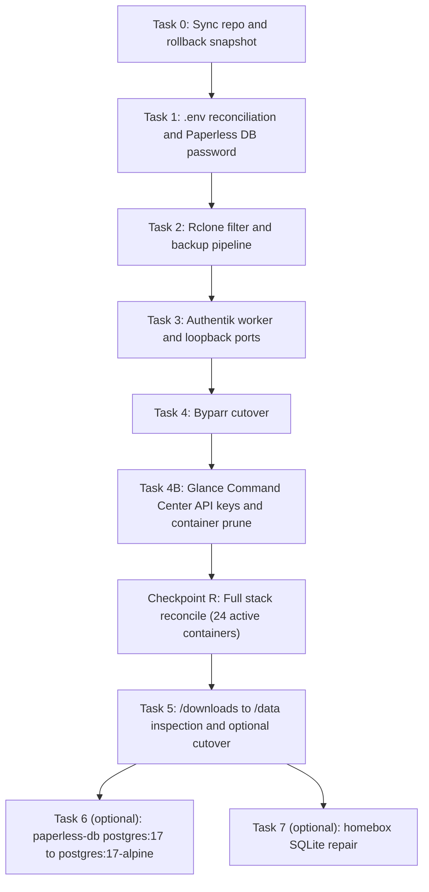

# Sol Local Verification Runbook (Gemini 3.8 Flash Execution Playbook)

> **Audience:** Varun's local Gemini 3.8 Flash agent (`flash_worker`) on the live Sol host.
> **Host:** Apple Silicon M1 Pro, macOS, OrbStack Docker engine, repository at `/Users/vrg/Documents/Sol`.
> **Origin:** October 2026 `/double-agent` architectural review. See [09_ARCHITECTURAL_AUDIT_AND_UPGRADE_PLAN.md](system_state/09_ARCHITECTURAL_AUDIT_AND_UPGRADE_PLAN.md).
> **Why this exists:** The remote review had no access to the untracked `.env`, `config/`, `data/`, `web/`, `quartz/`, or `/Volumes/PANOPTICON`. Every check that depends on live state is moved here as a deterministic step with an exact command, an expected output, a decision gate, and a rollback.

---

## Operating Rules for the Executing Agent

1. Run tasks in the order listed in [Execution Order](#execution-order). Do not skip a gate.
2. Each `run_command` call starts a new shell. Start every command block with `source /tmp/sol_rb.sh` (created in Task 0).
3. Never print secret values. Compare keys, hashes, or exit codes only. Never run `cat .env`, `env`, or `docker inspect` on the full `.Config.Env`.
4. A gate marked **STOP** means: stop all work, write the report in [Appendix C](#appendix-c-report-template), and wait for Varun.
5. Do not run `docker compose down`, `docker system prune`, `docker volume rm`, `rm -rf`, or `rclone purge` unless a step names that exact command and Varun approved it in this session.
6. Do not run `docker compose up -d --remove-orphans` during this runbook. Profile-gated services must stay known to Compose.
7. Quote the real output of every check in the final report. If a command fails, report the exact error line. Do not guess.
8. Optional tasks (6 and 7) need an explicit "go" from Varun before the first mutating step.

### Gate Notation

| Marker | Meaning |
| :--- | :--- |
| `EXPECT` | The output that means PASS. |
| `GATE` | The decision. Each branch names the next action. |
| `ROLLBACK` | The exact commands that restore the state captured before the task. |

---

## Execution Order



Why this order:

- Task 1 must run before any `docker compose up -d`. Recreating `paperless-webserver` with a mismatched password puts Paperless into a crash loop.
- Task 2 produces fresh PostgreSQL dumps and SQLite snapshots. That is the rollback point for every later task.
- Task 4 must remove the old `flaresolverr` container before `byparr` starts. Otherwise Docker DNS answers `flaresolverr` with two IP addresses.
- Checkpoint R recreates every changed service only after the three risky services above are verified.

---

## Task 0: Sync Repository and Capture a Rollback Snapshot

### 0.1 Create the session helper

```bash
cat > /tmp/sol_rb.sh <<'EOF'
set -uo pipefail
cd /Users/vrg/Documents/Sol || { echo "FATAL: repo root missing"; exit 1; }
# Read one .env value without sourcing the whole file and without printing it.
envget() { grep -E "^$1=" .env | tail -n1 | cut -d= -f2- | sed -e 's/^"\(.*\)"$/\1/' -e "s/^'\(.*\)'\$/\1/"; }
PRE="$(cat /tmp/sol_rb_pre 2>/dev/null || true)"
EOF
source /tmp/sol_rb.sh && pwd
```

`EXPECT`: `/Users/vrg/Documents/Sol`

### 0.2 Pull the updated repository

```bash
source /tmp/sol_rb.sh
if [ -d .jj ]; then jj st; jj git fetch; jj log -r 'main@origin' --no-graph -n 1; else git status --short; git fetch origin; git log -1 --oneline origin/main; fi
```

`GATE`:

- If `jj st` or `git status --short` shows tracked local edits, **STOP**. Varun must decide whether to keep or rebase them.
- Before pulling, archive any existing untracked `config/glance/config/glance.yml` or `config/glance/assets/user.css` so Git/JJ can check out the newly tracked declarative Glance configuration without an untracked-file collision:

```bash
source /tmp/sol_rb.sh
mkdir -p ./data/backups/preflight/glance_pre_pull
if [ -d config/glance ]; then
  cp -Rp config/glance ./data/backups/preflight/glance_pre_pull/
  rm -f config/glance/config/glance.yml config/glance/assets/user.css config/glance/assets/sol.svg
  echo "Archived pre-pull config/glance to ./data/backups/preflight/glance_pre_pull/"
fi
if [ -d .jj ]; then jj new main@origin; else git pull --ff-only origin main; fi
```

### 0.3 Confirm the checkout contains the upgrade

```bash
source /tmp/sol_rb.sh
test -f config/rclone/filter.txt.example && echo "OK filter.txt.example"
test -f config/glance/config/glance.yml && echo "OK glance.yml"
test -f config/glance/assets/user.css && echo "OK glance user.css"
grep -q 'thephaseless/byparr' compose/media.yml && echo "OK byparr"
test ! -f coder/default.tf && echo "OK default.tf removed"
grep -q '127.0.0.1:${COMPOSE_PORT_HTTP:-9000}:9000' compose/core.yml && echo "OK authentik loopback"
grep -q 'PAPERLESS_DBPASS' compose/paperless.yml && echo "OK paperless DBPASS"
```

`EXPECT`: seven `OK` lines. `GATE`: if any line is missing, **STOP** (the pull did not land the upgrade).

### 0.4 Record the current container state

```bash
source /tmp/sol_rb.sh
TS="$(date +%Y%m%d-%H%M%S)"; PRE="./data/backups/preflight/$TS"; mkdir -p "$PRE"; echo "$PRE" > /tmp/sol_rb_pre
docker ps -a --format '{{.Names}}\t{{.Image}}\t{{.Status}}' | sort > "$PRE/containers_before.tsv"
wc -l < "$PRE/containers_before.tsv"; echo "PRE=$PRE"
```

`./data/` is ignored by git. `data/backups/**` is included by the rclone filter, so this snapshot also reaches OneDrive on the next backup.

### 0.5 Copy every file this runbook can change

```bash
source /tmp/sol_rb.sh
cp -p .env "$PRE/env.before"
for f in config/rclone/filter.txt \
         config/qbittorrent/qBittorrent/qBittorrent.conf \
         config/qbittorrent/qBittorrent/categories.json \
         config/cross-seed/config.js; do
  if [ -f "$f" ]; then mkdir -p "$PRE/$(dirname "$f")"; cp -p "$f" "$PRE/$f"; echo "saved $f"; else echo "MISSING $f"; fi
done
for db in radarr/radarr.db sonarr/sonarr.db lidarr/lidarr.db prowlarr/prowlarr.db; do
  if [ -f "config/$db" ]; then sqlite3 "config/$db" ".timeout 5000" ".backup '$PRE/$(basename "$db")'" && echo "snapshot $db"; fi
done
ls -la "$PRE"
```

`EXPECT`: `saved` or `MISSING` for each file and `snapshot` for each existing `*arr` database. Report every `MISSING` line. A missing file is a finding, not a failure.

---

## Task 1: Pre-Flight and `.env` Reconciliation

### 1.1 Fix `.env` lines that break `bash source`

Background:

- Docker Compose accepts an unquoted value with spaces. Bash does not.
- The old template line `PAPERLESS_OCR_LANGUAGES=hin kan pan` makes `source ./.env` run the command `kan`. During the remote review, a test of the old `.env.example` under `set -euo pipefail` gave `./.env: line 76: kan: command not found` and exit code `127`.
- That review fixed both sides. `.env.example` now has `PAPERLESS_OCR_LANGUAGES="hin kan pan"` and a single-quoted `PAPERLESS_SOCIALACCOUNT_PROVIDERS='...'`. `scripts/backup.sh` and `scripts/restore.sh` now read `.env` with a line-by-line `load_env` parser. `scripts/test_cross_seed.sh` reads only `PUID` and `PGID` the same way. None of the three scripts runs `source ./.env` any more.
- The live `.env` was copied from the old template, so it can still hold the unquoted line. The scripts no longer care, but any manual `source .env` in an operator shell still fails. Fix the live file so both parsers agree.

Find unsafe lines (prints line number and key only):

```bash
source /tmp/sol_rb.sh
awk '/^[A-Za-z_][A-Za-z0-9_]*=/{k=substr($0,1,index($0,"=")-1); v=substr($0,index($0,"=")+1); if (v !~ /^["\047]/ && v ~ /[[:space:]]/) print NR": "k}' .env
```

`GATE`:

- If the output is empty, go to 1.2.
- If `PAPERLESS_OCR_LANGUAGES` is listed, wrap its value in double quotes:

```bash
source /tmp/sol_rb.sh
perl -pi -e 's/^PAPERLESS_OCR_LANGUAGES=([^"\x27].*)$/PAPERLESS_OCR_LANGUAGES="$1"/' .env
grep -n '^PAPERLESS_OCR_LANGUAGES=' .env
```

`EXPECT`: `PAPERLESS_OCR_LANGUAGES="hin kan pan"` (this value is not a secret).

- If any other key is listed, quote it the same way and name it in the report.

Bash strips the inner double quotes from an unquoted `PAPERLESS_SOCIALACCOUNT_PROVIDERS={...}` JSON line. Compose reads the raw line and is not affected. If the live line is unquoted, wrap the whole value in single quotes to match `.env.example`:

```bash
source /tmp/sol_rb.sh
perl -pi -e "s/^PAPERLESS_SOCIALACCOUNT_PROVIDERS=(\{.*\})\s*\$/PAPERLESS_SOCIALACCOUNT_PROVIDERS='\$1'/" .env
grep -c "^PAPERLESS_SOCIALACCOUNT_PROVIDERS='{" .env
docker compose config 2>/dev/null | grep -c 'OAUTH_PKCE_ENABLED'
```

`EXPECT`: `1` and `1` (Compose still sees the JSON after the quote change). The value holds an OIDC client secret, so never print the line.

Prove that a full `source` now succeeds and that the scripts parse the file:

```bash
source /tmp/sol_rb.sh
bash -c 'set -euo pipefail; set -a; source ./.env; set +a; echo SOURCE_OK'
grep -c 'load_env "./.env"' scripts/backup.sh scripts/restore.sh
grep -c 'source ./.env' scripts/backup.sh scripts/restore.sh scripts/test_cross_seed.sh
```

`EXPECT`: `SOURCE_OK`, a count of `1` for both `load_env` lines, and `0` for every `source ./.env` count. `GATE`: if `SOURCE_OK` is missing, re-run the scan above and quote the listed keys. If a script still contains `source ./.env`, the pull in Task 0 did not land the script fix, so **STOP**.

### 1.2 Check the bash version used by the scripts

The scripts use `#!/bin/bash`. On macOS that is bash 3.2. Under `set -u`, bash older than 4.4 treats an empty array expansion `"${arr[@]}"` as an unbound variable. `scripts/restore.sh` now uses the guarded form `${DRY_RUN_ARG[@]+"${DRY_RUN_ARG[@]}"}` and `${RCLONE_CONF_ARG[@]+"${RCLONE_CONF_ARG[@]}"}`, which works on every bash version.

```bash
/bin/bash --version | head -n1
/bin/bash -c 'set -u; a=(); echo "${a[@]}"; echo UNGUARDED_OK' 2>&1 | tail -n1
/bin/bash -c 'set -u; a=(); echo ${a[@]+"${a[@]}"}; echo GUARDED_OK'
grep -c 'DRY_RUN_ARG\[@\]+' scripts/restore.sh
```

`EXPECT`: a `version 3.2.x` line, then `a[@]: unbound variable` (proves the bash 3.2 behavior) or `UNGUARDED_OK` (newer bash), then `GUARDED_OK`, then `1`.

`GATE`: if `GUARDED_OK` is missing or the count is `0`, do not run `restore.sh` without `--dry-run` in this session. Report the output. `backup.sh` and `test_cross_seed.sh` use no arrays and are not affected.

### 1.3 Compare `.env` keys with `.env.example` (no values)

```bash
source /tmp/sol_rb.sh
keys() { grep -oE '^[A-Za-z_][A-Za-z0-9_]*=' "$1" | tr -d '=' | sort -u; }
echo "== In .env.example, missing from .env =="; comm -23 <(keys .env.example) <(keys .env)
echo "== In .env only (live extras) =="; comm -13 <(keys .env.example) <(keys .env)
echo "== Keys in .env still holding a template placeholder =="
awk '/^[A-Za-z_][A-Za-z0-9_]*=/{k=substr($0,1,index($0,"=")-1); v=substr($0,index($0,"=")+1); gsub(/^["\047]|["\047]$/,"",v); if (v ~ /^(your_|generate_with_)/) print NR": "k}' .env
```

`GATE`:

- Missing tag keys (`CADDY_TAG`, `PAPERLESS_TAG`, `ARCANE_TAG`, `CODER_TAG`): fix in 1.4.
- Missing `SONARR_API_KEY`, `RADARR_API_KEY`, `LIDARR_API_KEY`: only `unpackerr` (standby) reads them, with `:-` empty defaults. Record and continue.
- Missing `PAPERLESS_DB_NAME`, `PAPERLESS_DB_USER`, or `PAPERLESS_DB_PASS`: Compose falls back to `paperless`. Task 1.5 handles this.
- A placeholder on `PG_PASS`, `AUTHENTIK_SECRET_KEY`, `PAPERLESS_SECRET_KEY`, or `PAPERLESS_DB_PASS`: **STOP**. A live stack cannot run on template values.
- Live-only keys: list them in the report. Do not delete them.

### 1.4 Add the new image tag pins and check for downgrades

The upgrade replaced `:latest` with `.env` driven tags on four stateful images:

| Variable | Default in `.env.example` | Image reference |
| :--- | :--- | :--- |
| `CADDY_TAG` | `2` | `caddy:${CADDY_TAG:-2}` |
| `PAPERLESS_TAG` | `2` | `ghcr.io/paperless-ngx/paperless-ngx:${PAPERLESS_TAG:-2}` |
| `ARCANE_TAG` | `latest` | `ghcr.io/getarcaneapp/arcane:${ARCANE_TAG:-latest}` |
| `CODER_TAG` | `latest` | `ghcr.io/coder/coder:${CODER_TAG:-latest}` |

`AUTHENTIK_IMAGE` and `AUTHENTIK_TAG=2026.5.3` were already pinned. They only moved into the new tag block.

Check the running versions first. Paperless and Caddy were on `:latest`, and a database schema cannot migrate backwards:

```bash
source /tmp/sol_rb.sh
for c in caddy paperless-webserver arcane coder authentik-server; do
  printf '%-22s ' "$c"
  docker inspect "$c" --format '{{.Config.Image}}  version={{index .Config.Labels "org.opencontainers.image.version"}}' 2>/dev/null || echo "not running"
done
```

`GATE`:

- If `paperless-webserver` reports a version that starts with `2.`, the pin `2` is safe.
- If it reports `3.` or higher, do not use `PAPERLESS_TAG=2`. Set `PAPERLESS_TAG` to the running major version instead and record it.
- If `caddy` reports `2.x`, the pin `2` is safe.
- If a label is empty, run `docker exec paperless-webserver python3 -c "import paperless.version as v; print(v.__full_version_str__)"` from `/usr/src/paperless/src`. If the version is still unknown, **STOP**.

Add any missing tag keys without touching existing values (idempotent):

```bash
source /tmp/sol_rb.sh
for kv in CADDY_TAG=2 PAPERLESS_TAG=2 ARCANE_TAG=latest CODER_TAG=latest; do
  k="${kv%%=*}"
  if grep -q "^${k}=" .env; then echo "keep $k"; else echo "$kv" >> .env; echo "added $kv"; fi
done
docker compose config -q && echo COMPOSE_CONFIG_OK
```

`EXPECT`: `keep` or `added` for each key, then `COMPOSE_CONFIG_OK`.

### 1.5 Verify the Paperless PostgreSQL role password

Background:

- Before the upgrade, `paperless-webserver` set `PAPERLESS_DBHOST` only. It never sent `PAPERLESS_DBUSER`, `PAPERLESS_DBPASS`, or `PAPERLESS_DBNAME`, so Paperless used its built-in default password `paperless`.
- The upgrade now sends `PAPERLESS_DBPASS: ${PAPERLESS_DB_PASS:-paperless}`.
- `POSTGRES_PASSWORD` on `paperless-db` is read only when `initdb` runs on an empty `data/paperless/db`. Changing `.env` never changes the password of an existing role.
- Result: if `.env` holds a custom `PAPERLESS_DB_PASS` but the role was created with `paperless`, the recreated webserver fails with `password authentication failed for user "paperless"`.

Why `docker exec paperless-db psql -U paperless -d paperless -c "SELECT 1;"` is not enough: the official `postgres` image trusts the local Unix socket and `127.0.0.1`. That command always succeeds and does not test the password. The test below connects over the Docker bridge network, which uses the image's `host all all all scram-sha-256` rule.

```bash
source /tmp/sol_rb.sh
grep -c '^PAPERLESS_DB_PASS=' .env
docker exec paperless-db psql -U "$(envget PAPERLESS_DB_USER || echo paperless)" -d "$(envget PAPERLESS_DB_NAME || echo paperless)" -tAc "SELECT 1;"
NET="$(docker inspect paperless-db --format '{{range $k,$v := .NetworkSettings.Networks}}{{$k}}{{end}}')"; echo "NET=$NET"
U="$(envget PAPERLESS_DB_USER)"; U="${U:-paperless}"; D="$(envget PAPERLESS_DB_NAME)"; D="${D:-paperless}"
export PGPASSWORD="$(envget PAPERLESS_DB_PASS)"; PGPASSWORD="${PGPASSWORD:-paperless}"
docker run --rm --network "$NET" -e PGPASSWORD docker.io/library/postgres:17 \
  psql -h paperless-db -U "$U" -d "$D" -tAc "SELECT 'ENV_PASSWORD_OK';" 2>&1 | tail -n1
export PGPASSWORD=paperless
docker run --rm --network "$NET" -e PGPASSWORD docker.io/library/postgres:17 \
  psql -h paperless-db -U "$U" -d "$D" -tAc "SELECT 'DEFAULT_PASSWORD_OK';" 2>&1 | tail -n1
docker logs paperless-webserver --tail 50 2>&1 | grep -ciE 'password authentication failed|could not connect to server'
```

`EXPECT`: `1`, `1`, `NET=sol_default`, then one or both of `ENV_PASSWORD_OK` / `DEFAULT_PASSWORD_OK`, then a count.

`GATE`:

| Env password | Default `paperless` | Meaning | Action |
| :--- | :--- | :--- | :--- |
| `ENV_PASSWORD_OK` | any | Role password matches `.env`. | Go to 1.6. |
| fails | `DEFAULT_PASSWORD_OK` | Role still uses `paperless`. The old webserver worked only through the fallback. | Fix A (preferred) or Fix B, then repeat 1.5. |
| fails | fails | Unknown role password. | **STOP**. Report both error lines and the log count. |

Fix A (preferred): set the role password to the `.env` value. The password goes through a psql variable on stdin, so it never appears in the process list or the logs:

```bash
source /tmp/sol_rb.sh
U="$(envget PAPERLESS_DB_USER)"; U="${U:-paperless}"; D="$(envget PAPERLESS_DB_NAME)"; D="${D:-paperless}"
printf '%s\n' "ALTER ROLE \"$U\" WITH PASSWORD :'pw';" | \
  docker exec -i paperless-db psql -U "$U" -d "$D" -v ON_ERROR_STOP=1 -v pw="$(envget PAPERLESS_DB_PASS)"
```

`EXPECT`: `ALTER ROLE`.

Fix B (fallback, weaker): set `PAPERLESS_DB_PASS` in `.env` to the current role password `paperless`. Use this only if Varun declines Fix A.

`ROLLBACK` for Fix A: run the same command with the literal value `paperless` in place of `$(envget PAPERLESS_DB_PASS)`, then restore `.env` with `cp -p "$PRE/env.before" .env`.

### 1.6 Recreate the Paperless services

`paperless-broker` also moved from `redis:8` to `redis:8-alpine`. The Redis 8 data format in `data/paperless/redis` does not change between the Debian and Alpine builds.

```bash
source /tmp/sol_rb.sh
docker compose pull paperless-webserver paperless-broker paperless-db
docker compose up -d paperless-db paperless-broker paperless-webserver
sleep 45
docker compose ps paperless-webserver paperless-broker paperless-db
docker logs paperless-webserver --since 2m 2>&1 | grep -iE 'password authentication failed|OperationalError|Traceback' | head -n 5
curl -s -o /dev/null -w 'docs.vrg.rocks HTTP %{http_code}\n' https://docs.vrg.rocks/
```

`EXPECT`: all three services `Up` (`healthy` where a healthcheck exists), no lines from the log grep, and HTTP `200` or `302`.

`GATE`: an authentication error means 1.5 was not completed. Go back to 1.5. Any other traceback means **STOP**.

`ROLLBACK`: `cp -p "$PRE/env.before" .env && docker compose up -d paperless-webserver`.

---

## Task 2: Rclone Filter and Backup Pipeline Verification

### 2.1 Compare the live filter with the tracked template

```bash
source /tmp/sol_rb.sh
ls -la config/rclone/
if [ -f config/rclone/filter.txt ]; then diff -u config/rclone/filter.txt config/rclone/filter.txt.example; else echo "NO LIVE filter.txt"; fi
for rule in '- data/authentik/**' '- data/paperless/db/**' '- data/paperless/redis/**' '- **/*-wal' '- **/*-shm'; do
  grep -qxF -- "$rule" config/rclone/filter.txt 2>/dev/null && echo "PRESENT  $rule" || echo "MISSING  $rule"
done
```

`GATE`:

- If all five rules are `PRESENT`, check their position. Rclone uses the first matching rule. Each exclusion must appear above any line that would include the same path (`+ **`, `+ data/**`, or `+ config/**`). Use `grep -n` to compare line numbers.
- If any rule is `MISSING`, or if it sits below a broader include, merge as follows:
  1. List live-only rules: `comm -23 <(grep -E '^[+-] ' config/rclone/filter.txt | sort -u) <(grep -E '^[+-] ' config/rclone/filter.txt.example | sort -u)`.
  2. Copy the template: `cp config/rclone/filter.txt.example config/rclone/filter.txt`.
  3. Re-insert each live-only rule above section `# 7. Default Rule` (the final `+ **`). Show the full `diff -u "$PRE/config/rclone/filter.txt" config/rclone/filter.txt` in the report.
- If there is no live `filter.txt`, `backup.sh` falls back to `filter.txt.example` on its own. Create the live copy anyway: `cp config/rclone/filter.txt.example config/rclone/filter.txt`.

### 2.2 Prove the filter locally (no network, no writes)

```bash
source /tmp/sol_rb.sh
echo "== Paths that must be excluded (expect 0) =="
rclone lsf -R --files-only --filter-from config/rclone/filter.txt . 2>/dev/null \
  | grep -cE '^data/authentik/|^data/paperless/db/|^data/paperless/redis/|-(wal|shm)$'
echo "== Bulk media and payload leaks (expect 0) =="
rclone lsf -R --files-only --filter-from config/rclone/filter.txt . 2>/dev/null \
  | grep -E '^data/(media|torrents)/' | grep -vcE '^data/media/preshows/|\.torrent$|\.fastresume$'
```

`EXPECT`: `0` and `0`. `GATE`: any non-zero count means the merge in 2.1 is wrong. Fix it before you run 2.4.

### 2.3 Check SQLite coverage

```bash
sqlite3 --version
source /tmp/sol_rb.sh
echo "== SQLite files OUTSIDE backup.sh snapshot scope (./config, ./data/arcane, ./data/ignis) =="
find ./data -maxdepth 5 \( -name '*.db' -o -name '*.sqlite' -o -name '*.sqlite3' \) -type f 2>/dev/null \
  | grep -vE '^\./data/(arcane|ignis|backups|media|torrents|authentik|paperless/db)/' | sort
echo "== SQLite files deeper than maxdepth 4 under ./config (missed by backup.sh) =="
find ./config -mindepth 5 \( -name '*.db' -o -name '*.sqlite' -o -name '*.sqlite3' \) -type f 2>/dev/null | sort
```

`EXPECT`: `sqlite3 --version` prints `3.x`. macOS ships `/usr/bin/sqlite3`. Version `3.29` or later is needed for `.recover` in Task 7.

`GATE`: the filter excludes every `-wal` and `-shm` file, so any listed database that belongs to a running service may reach OneDrive without its last transactions. Known examples are `data/homebox/` (standby, so safe while stopped), `data/copyparty/.hist/` (rebuildable index), and `data/beszel` or `data/uptime-kuma` (standby). List each file in the report with its owning service and that service's running state. Do not edit `backup.sh` in this session.

### 2.4 Run the backup pipeline

```bash
source /tmp/sol_rb.sh
./scripts/backup.sh; echo "BACKUP_EXIT=$?"
```

`EXPECT` (log lines from the script):

- `✓ Authentik DB dumped to data/backups/authentik_db.sql.gz`
- `✓ Paperless DB dumped to data/backups/paperless_db.sql.gz`
- One `✓ Snapshot: <path> -> data/backups/sqlite/<path_with__separators>` line per SQLite file
- `Using native host rclone CLI (rclone v...)` or `Using containerized rclone via Docker Compose (--profile ops)...`
- `✓ Sol Server Backup completed successfully.`
- `BACKUP_EXIT=0`

`GATE`:

- If you see `kan: command not found`, the checkout still has the old `source ./.env` script. Go back to Task 0.3 and 1.1.
- If you see `⚠ Warning: ... DB dump failed`, run `docker exec authentik-postgresql pg_dump -U "$(envget PG_USER)" "$(envget PG_DB)" > /dev/null` (or the Paperless equivalent) and report the error line.
- If `BACKUP_EXIT` is non-zero after the rclone step, the script works as designed (`set -o pipefail` now surfaces rclone failures). Report the last 30 lines of the newest `logs/backup_*.log`. Common causes are an expired OneDrive token (`rclone config reconnect OneDrive:`) or a missing `config/rclone/rclone.conf`.

### 2.5 Verify the artifacts

```bash
source /tmp/sol_rb.sh
ls -la data/backups/authentik_db.sql.gz data/backups/paperless_db.sql.gz
gzip -t data/backups/authentik_db.sql.gz && echo "authentik dump gzip OK"
gzip -t data/backups/paperless_db.sql.gz && echo "paperless dump gzip OK"
gunzip -c data/backups/paperless_db.sql.gz | grep -c '^CREATE TABLE'
bad=0; for f in data/backups/sqlite/*; do r="$(sqlite3 "$f" 'PRAGMA integrity_check;' 2>&1 | head -n1)"; [ "$r" = "ok" ] || { echo "BAD $f: $r"; bad=$((bad+1)); }; done; echo "sqlite snapshots not ok: $bad"
ls data/backups/sqlite | wc -l
rclone lsd OneDrive:Sol-archive --config config/rclone/rclone.conf 2>&1 | tail -n 3
rclone lsl OneDrive:Sol/data/backups --config config/rclone/rclone.conf --max-depth 1 2>&1 | head -n 5
```

`EXPECT`: both dumps non-empty with `gzip OK`, a `CREATE TABLE` count above `0`, `sqlite snapshots not ok: 0`, and the dumps listed under `OneDrive:Sol/data/backups`.

`OneDrive:Sol-archive/<timestamp>` appears only when the sync replaced or deleted a remote file. An empty `Sol-archive` after the first run is not a failure.

### 2.6 Optional: remove stale raw database copies from OneDrive

`rclone sync` does not delete newly excluded paths from the destination unless `--delete-excluded` is set. Raw cluster files from earlier backups may still exist under `OneDrive:Sol/data/authentik/`, `OneDrive:Sol/data/paperless/db/`, and as `-wal`/`-shm` files. They are not consistent snapshots and are now superseded by the dumps.

```bash
source /tmp/sol_rb.sh
for p in data/authentik data/paperless/db data/paperless/redis; do
  printf '%-24s ' "$p"; rclone size "OneDrive:Sol/$p" --config config/rclone/rclone.conf 2>&1 | tr '\n' ' '; echo
done
```

`GATE`: report the sizes only. Deleting them (`rclone purge OneDrive:Sol/<path>`) is destructive and needs Varun's explicit approval.

`ROLLBACK` for Task 2: `cp -p "$PRE/config/rclone/filter.txt" config/rclone/filter.txt`.

---

## Task 3: Authentik Worker and Loopback Port Verification

The upgrade made three changes in `compose/core.yml`:

- `authentik-server` publishes `127.0.0.1:${COMPOSE_PORT_HTTP:-9000}:9000` and `127.0.0.1:${COMPOSE_PORT_HTTPS:-9443}:9443` (was `0.0.0.0`).
- `authentik-worker` no longer runs as `user: root` and no longer mounts `/var/run/docker.sock`.
- `AUTHENTIK_WORKERS: 2` (not an upstream variable) became `AUTHENTIK_WEB__WORKERS: 2`.

The worker needs the Docker socket only when an outpost is deployed through a Docker service connection. Caddy uses the embedded outpost at `authentik-server:9000/outpost.goauthentik.io/auth/caddy`, so it does not need one.

### 3.1 Confirm no outpost depends on a Docker service connection

```bash
source /tmp/sol_rb.sh
U="$(envget PG_USER)"; U="${U:-authentik}"; D="$(envget PG_DB)"; D="${D:-authentik}"
docker exec authentik-postgresql psql -U "$U" -d "$D" -c "\dt authentik_outposts_*"
docker exec authentik-postgresql psql -U "$U" -d "$D" -c "SELECT name, type, managed, service_connection_id FROM authentik_outposts_outpost;"
docker exec authentik-postgresql psql -U "$U" -d "$D" -c "SELECT * FROM authentik_outposts_outpostserviceconnection;"
```

If a column name errors, run `\d authentik_outposts_outpost` and re-run the `SELECT` with the real column names. Report the schema you used.

`GATE`:

- PASS if the only outpost is `authentik Embedded Outpost` (`managed` = `goauthentik.io/outposts/embedded`), or if every other outpost has an empty `service_connection_id`.
- A row named `Local Docker connection` in `authentik_outposts_outpostserviceconnection` is created automatically when Authentik first sees a socket. It is harmless if no outpost references its `uuid`.
- If any non-embedded outpost references a Docker service connection, **STOP**. That outpost needs the socket back. Varun must choose between restoring `user: root` plus the socket mount, or moving that outpost to the embedded one.

The Admin UI shows the same data at `https://auth.vrg.rocks/if/admin/#/outpost/outposts` and `/outpost/integrations`.

### 3.2 Recreate the Authentik services

```bash
source /tmp/sol_rb.sh
docker compose up -d authentik-server authentik-worker
sleep 40
docker compose ps authentik-server authentik-worker authentik-postgresql
docker port authentik-server
docker exec authentik-worker id
docker logs authentik-worker --since 2m 2>&1 | grep -iE 'error|exception|traceback' | head -n 10
curl -s -o /dev/null -w 'loopback live HTTP %{http_code}\n' http://127.0.0.1:9000/-/health/live/
curl -s -o /dev/null -w 'loopback ready HTTP %{http_code}\n' http://127.0.0.1:9000/-/health/ready/
```

`EXPECT`:

- All three services `Up`, with `authentik-postgresql` `healthy`.
- `docker port` prints exactly `9000/tcp -> 127.0.0.1:9000` and `9443/tcp -> 127.0.0.1:9443`.
- `id` shows a non-zero uid (the image default user).
- No error lines, or only lines about the unused local Docker service connection (for example, a Docker client that cannot connect). Report those lines verbatim.
- Both health probes return `200`.

### 3.3 Confirm the LAN exposure is closed and the edge still works

```bash
source /tmp/sol_rb.sh
LANIP="$(ipconfig getifaddr en0 || ipconfig getifaddr en1)"; echo "LANIP=$LANIP"
curl -s -m 5 -o /dev/null -w 'LAN 9000 HTTP %{http_code}\n' "http://$LANIP:9000/-/health/live/" || echo "LAN 9000 closed (expected)"
curl -s -o /dev/null -w 'auth.vrg.rocks HTTP %{http_code}\n' https://auth.vrg.rocks/-/health/live/
for h in dash code arcane radarr; do curl -s -o /dev/null -w "$h.vrg.rocks HTTP %{http_code} -> %{redirect_url}\n" "https://$h.vrg.rocks/"; done
curl -s -o /dev/null -w 'qb.vrg.rocks HTTP %{http_code} -> %{redirect_url}\n' https://qb.vrg.rocks/
```

`EXPECT`:

- The LAN probe fails or prints `000`.
- `auth.vrg.rocks` returns `200`.
- `dash`, `code`, `arcane`, and `radarr` return `302` with a redirect URL under `https://auth.vrg.rocks/`.
- `qb.vrg.rocks` returns `200` with no redirect (qBittorrent native login, kept for the Android client).

`GATE`: if `dash` or `code` returns `200` with no redirect, Caddy is still running the old Caddyfile. Run 3.4.

### 3.4 Make sure Caddy loaded the new Caddyfile

`compose/core.yml` bind-mounts the single file `${DOCKER_BASE_DIR}/Caddyfile`. A `git pull` or `jj new` writes a new inode. A single-file bind mount can keep the old inode, so `caddy reload` may read stale content.

```bash
source /tmp/sol_rb.sh
shasum -a 256 Caddyfile | cut -d' ' -f1
docker exec caddy sha256sum /etc/caddy/Caddyfile | cut -d' ' -f1
docker exec caddy caddy validate --config /etc/caddy/Caddyfile --adapter caddyfile 2>&1 | tail -n 2
```

`GATE`:

- If the hashes match and validation prints `Valid configuration`, run `docker exec caddy caddy reload --config /etc/caddy/Caddyfile --adapter caddyfile`.
- If the hashes differ, run `docker compose up -d --force-recreate caddy`, wait 15 seconds, then repeat 3.3.

`ROLLBACK` for Task 3: revert `compose/core.yml` with `git checkout <previous-commit> -- compose/core.yml` (or `jj restore --from <previous-change> compose/core.yml`), then `docker compose up -d authentik-server authentik-worker`.

---

## Task 4: Byparr Cutover Verification

`compose/media.yml` now runs `byparr` (`ghcr.io/thephaseless/byparr:latest`) as the active Cloudflare Turnstile solver on port `8191`. It holds the Docker network alias `flaresolverr`, so Prowlarr's existing proxy URL `http://flaresolverr:8191` needs no change. The legacy `flaresolverr` service moved to the `standby` profile. Caddy routes `byparr.vrg.rocks` and `flaresolverr.vrg.rocks` to `http://byparr:8191` behind `import forward_auth`.

### 4.1 Record the Prowlarr proxy settings

```bash
source /tmp/sol_rb.sh
sqlite3 -readonly config/prowlarr/prowlarr.db "SELECT Id, Name, Implementation, json_extract(Settings,'\$.host') AS host, Tags FROM IndexerProxies;"
```

`EXPECT`: one `FlareSolverr` row with host `http://flaresolverr:8191/` (or without the trailing slash). Prowlarr sends a request through the proxy only for indexers that share a tag with that proxy row. Record the `Tags` value.

### 4.2 Remove the old container and start Byparr

```bash
source /tmp/sol_rb.sh
docker compose pull byparr
docker image inspect ghcr.io/thephaseless/byparr:latest --format 'arch={{.Architecture}}'
docker stop flaresolverr && docker rm flaresolverr
docker compose up -d byparr
sleep 20
docker compose ps byparr
docker logs byparr --since 1m 2>&1 | tail -n 15
```

`EXPECT`: `arch=arm64`, `flaresolverr` printed twice (stop and rm), and `byparr` `Up`.

`GATE`:

- If `arch=amd64`, OrbStack runs the image under Rosetta. It works but is slower. Record it and continue.
- If `docker stop flaresolverr` says `No such container`, it was already gone. Continue.

### 4.3 Verify DNS and the API from inside Prowlarr

```bash
source /tmp/sol_rb.sh
echo "byparr IP: $(docker inspect byparr --format '{{range .NetworkSettings.Networks}}{{.IPAddress}} {{end}}')"
docker exec prowlarr getent hosts flaresolverr
docker exec prowlarr getent hosts byparr
docker exec prowlarr curl -s -o /dev/null -w 'GET flaresolverr:8191/ HTTP %{http_code}\n' http://flaresolverr:8191/
docker exec prowlarr curl -s -o /dev/null -w 'GET flaresolverr:8191/v1 HTTP %{http_code}\n' http://flaresolverr:8191/v1
docker exec prowlarr curl -s -m 90 -X POST http://flaresolverr:8191/v1 \
  -H 'Content-Type: application/json' \
  -d '{"cmd":"request.get","url":"https://www.google.com/","maxTimeout":60000}' | head -c 400; echo
```

`EXPECT`:

- `getent hosts flaresolverr` returns exactly one IP, and it equals the Byparr IP. Two IPs mean a second container still holds the name, so go back to 4.2.
- `GET /` returns an HTTP status (any non-`000` value proves the listener is up). `GET /v1` may return `405` because the endpoint expects `POST`. That is not a failure.
- The `POST /v1` body is FlareSolverr-compatible JSON with `"status":"ok"` and a `"solution"` object.

`GATE`: if `curl` is not found in the Prowlarr container, use `docker exec prowlarr wget -qO- --post-data='<same JSON>' --header='Content-Type: application/json' http://flaresolverr:8191/v1`. A `"status":"error"` body or a timeout means **STOP**. Report the body and `docker logs byparr --tail 40`.

### 4.4 Test indexers end to end

```bash
source /tmp/sol_rb.sh
docker exec prowlarr sh -c 'K=$(sed -n "s:.*<ApiKey>\(.*\)</ApiKey>.*:\1:p" /config/config.xml); curl -s -m 300 -X POST -H "X-Api-Key: $K" http://localhost:9696/api/v1/indexer/testall' \
  | python3 -c 'import json,sys; r=json.load(sys.stdin); print("valid", sum(1 for x in r if x.get("isValid")), "of", len(r)); [print("FAIL id", x.get("id"), [f.get("errorMessage") for f in x.get("validationFailures",[])]) for x in r if not x.get("isValid")]'
```

`EXPECT`: `valid N of N`. The API key is read inside the container and is not printed.

`GATE`: if only indexers without the proxy tag fail, the cause is upstream (tracker down or DNS), not Byparr. If an indexer with the proxy tag fails with a Cloudflare or challenge message, report it. Then also test it once in the UI (`https://prowlarr.vrg.rocks` > Indexers > the indexer > Test).

`ROLLBACK` for Task 4:

```bash
source /tmp/sol_rb.sh
docker compose stop byparr && docker compose rm -f byparr
docker compose --profile standby up -d flaresolverr
docker exec prowlarr getent hosts flaresolverr
```

---

## Task 4B: Glance Command Center Revamp and Automatic API Key Extraction

The repository now tracks a 3-page declarative Glance configuration (`config/glance/config/glance.yml`), custom Catppuccin Mocha / GM3 stylesheet (`config/glance/assets/user.css`), and brand icon (`config/glance/assets/sol.svg`).

1. **Page 1 (`Sol`, `slug: sol`):** Serves both `https://dash.vrg.rocks/` and `https://sol.vrg.rocks` (`-> https://dash.vrg.rocks/sol`). Includes 4-zone World Flight Deck clocks (`Asia/Kolkata`, `America/Los_Angeles`, `UTC`, `Europe/London`), Bengaluru weather, M1 Pro `server-stats` (`OrbStack VM` + `/media/panopticon` 22TB WD Elements), Paperless-ngx vault telemetry, `!bang` search bar (`!jf`, `!metal`, `!req`, `!rad`, `!son`, `!prowl`, `!docs`, `!lb`, `!imdb`, `!blu`, `!fr24`), internal Docker bridge health monitors, complete active + standby service directory, live `docker-containers` status (`running-only: false`), and an ops scratchpad.
2. **Page 2 (`Cinema & Media`, `slug: media`):** Dual Jellyfin (`jellyfin:8096` + native macOS `host.docker.internal:8097` Apple VideoToolbox) library & active stream telemetry, Seerr request counts, Prowlarr indexer health, split-column Radarr & Sonarr active download queues and upcoming release calendars, Cinema/VFX/OLED YouTube channels (`Every Frame a Painting`, `Thomas Flight`, `Corridor Crew`, `Taskmaster`, `HDTVTest`, `RedLetterMedia`, `Captain Disillusion`, `LEMMiNO`), `r/imax` / `r/criterion` / `r/4kbluray` / `r/TrueFilm` / `r/hometheater` / `r/Taskmaster` feeds, and media stack GitHub releases.
3. **Page 3 (`Engineering & Radar`, `slug: radar`):** The Pantheon of interactive explainers (`Bartosz Ciechanowski`, `Sam Rose`, `Ahmad Shadeed`, `Nicky Case`, `Bret Victor`), Browser Engine Internals & Compiler-First Web Stack (`V8`, `Chrome`, `web.dev`, `Svelte`, `Astro`, `Bun`, `Datastar`, `PocketBase`, `jj`), Airbus Flight Deck resources, `varungupta3009/Sol` repository widget, Hacker News, Lobste.rs, and engineering/aviation video & subreddit feeds.

### 4B.1 Automatically extract local API keys into `.env`

All `custom-api` widgets in `glance.yml` degrade gracefully when their `.env` key is empty, but extracting the keys from the local `config/` files lights up every telemetry card immediately without manual UI copying. Run this idempotent extractor (it never prints secret values to stdout):

```bash
source /tmp/sol_rb.sh
python3 - <<'PY'
import json, pathlib, re, sqlite3

env_path = pathlib.Path(".env")
env_text = env_path.read_text()

def set_env(key: str, val: str) -> str:
    global env_text
    if not val:
        return "skipped (not found locally)"
    pat = re.compile(rf"^{re.escape(key)}=(.*)$", re.M)
    m = pat.search(env_text)
    if m:
        cur = m.group(1).strip().strip("'\"")
        if cur and not cur.startswith("your_"):
            return "kept existing non-empty value"
        env_text = pat.sub(f"{key}={val}", env_text)
        return "updated existing key"
    env_text = env_text.rstrip("\n") + f"\n{key}={val}\n"
    return "appended key"

def xml_key(p: str) -> str:
    f = pathlib.Path(p)
    if not f.exists():
        return ""
    m = re.search(r"<ApiKey>([^<]+)</ApiKey>", f.read_text())
    return m.group(1).strip() if m else ""

def seerr_key(p: str) -> str:
    f = pathlib.Path(p)
    if not f.exists():
        return ""
    try:
        return json.loads(f.read_text()).get("main", {}).get("apiKey", "").strip()
    except Exception:
        return ""

def jellyfin_key(db_path: str) -> str:
    f = pathlib.Path(db_path)
    if not f.exists():
        return ""
    try:
        con = sqlite3.connect(f"file:{f}?mode=ro", uri=True)
        cur = con.cursor()
        for tbl in ("ApiKeys", "Devices"):
            try:
                cur.execute(f"SELECT AccessToken FROM {tbl} WHERE AccessToken IS NOT NULL AND AccessToken != '' LIMIT 1;")
                row = cur.fetchone()
                if row and row[0]:
                    con.close()
                    return str(row[0]).strip()
            except Exception:
                pass
        con.close()
    except Exception:
        pass
    return ""

results = {
    "RADARR_API_KEY": set_env("RADARR_API_KEY", xml_key("config/radarr/config.xml")),
    "SONARR_API_KEY": set_env("SONARR_API_KEY", xml_key("config/sonarr/config.xml")),
    "PROWLARR_API_KEY": set_env("PROWLARR_API_KEY", xml_key("config/prowlarr/config.xml")),
    "LIDARR_API_KEY": set_env("LIDARR_API_KEY", xml_key("config/lidarr/config.xml")),
    "SEERR_API_KEY": set_env("SEERR_API_KEY", seerr_key("config/seerr/settings.json")),
    "JELLYFIN_API_KEY": set_env("JELLYFIN_API_KEY", jellyfin_key("config/jellyfin/data/jellyfin.db")),
    "JELLYFIN_METAL_API_KEY": set_env("JELLYFIN_METAL_API_KEY", jellyfin_key("config/jellyfin_metal/data/jellyfin.db")),
}
for empty_k in ("PAPERLESS_API_KEY", "GITHUB_TOKEN"):
    if not re.search(rf"^{empty_k}=", env_text, re.M):
        env_text = env_text.rstrip("\n") + f"\n{empty_k}=\n"
        results[empty_k] = "initialized empty key"
    else:
        results[empty_k] = "present"

env_path.write_text(env_text)
for k, status in results.items():
    print(f"{k:24s} -> {status}")
PY
```

`EXPECT`: status lines (`updated existing key`, `appended key`, or `kept existing non-empty value`) for each API key without printing any secret tokens.

Optional: if `PAPERLESS_API_KEY` is still empty and `paperless-webserver` is up, mint or read an admin DRF token inside `paperless-webserver` and store it in `.env`:

```bash
source /tmp/sol_rb.sh
if [ -z "$(envget PAPERLESS_API_KEY)" ]; then
  TOK="$(docker exec paperless-webserver python3 manage.py shell -c '
from django.contrib.auth.models import User
from rest_framework.authtoken.models import Token
u = User.objects.filter(is_superuser=True).first()
if u:
    t, _ = Token.objects.get_or_create(user=u)
    print(t.key)
' 2>/dev/null | tail -n1 | tr -d "\r")"
  if [ -n "$TOK" ] && [ "${#TOK}" -ge 30 ]; then
    perl -pi -e "s/^PAPERLESS_API_KEY=.*\$/PAPERLESS_API_KEY=$TOK/" .env
    echo "PAPERLESS_API_KEY        -> populated from paperless-webserver DRF Token"
  else
    echo "PAPERLESS_API_KEY        -> skipped (no superuser token returned)"
  fi
fi
```

### 4B.2 Prune stopped legacy containers and verify Glance

Glance's `docker-containers` widget sets `running-only: false` so any active container that crashes (`exited`) shows a red failure badge. To prevent stopped pre-refactor standby containers from cluttering the widget, remove stopped containers before Checkpoint R:

```bash
source /tmp/sol_rb.sh
echo "== Stopped containers before prune =="
docker ps -a --filter status=exited --filter status=created --format '{{.Names}}\t{{.Status}}'
docker container prune -f
docker compose up -d glance && sleep 10
docker logs glance --tail 30 2>&1
docker exec caddy wget -qO- -S http://glance:8080/sol 2>&1 | head -n 5
```

`EXPECT`: `docker logs glance` shows zero YAML or template parse errors, and `http://glance:8080/sol` returns `HTTP/1.1 200 OK`.

`ROLLBACK` for Task 4B: restore `./data/backups/preflight/glance_pre_pull/glance` if needed.

---

## Checkpoint R: Full Stack Reconcile

Tasks 1 to 4 recreated the risky services. This checkpoint applies every remaining compose change: the new tag pins, `TZ` in place of `/etc/timezone` on `glance`, removed `:z` suffixes, `arcane` `LOG_LEVEL: info`, and the dual `/downloads` plus `/data` mounts on `qbittorrent` and `cross-seed`.

```bash
source /tmp/sol_rb.sh
docker compose config --services | sort > /tmp/sol_expected.txt; wc -l < /tmp/sol_expected.txt
docker compose pull
docker compose up -d
sleep 60
docker ps --format '{{.Names}}' | sort > /tmp/sol_running.txt
echo "== Expected but not running =="; comm -23 /tmp/sol_expected.txt /tmp/sol_running.txt
echo "== Running but not in the default (no-profile) set =="; comm -13 /tmp/sol_expected.txt /tmp/sol_running.txt
docker compose ps --format '{{.Name}}\t{{.Status}}' | grep -viE 'Up' || echo "ALL UP"
pgrep -fl 'Jellyfin.app/Contents/MacOS/jellyfin' || echo "jellyfin-metal not running"
```

`EXPECT`: `24` expected services, an empty "Expected but not running" list, and `ALL UP`.

The 24 active services are `caddy`, `authentik-postgresql`, `authentik-server`, `authentik-worker`, `arcane`, `glance`, `jellyfin`, `seerr`, `radarr`, `sonarr`, `bazarr`, `lidarr`, `prowlarr`, `byparr`, `qbittorrent`, `cross-seed`, `paperless-webserver`, `paperless-broker`, `paperless-db`, `ignis`, `code-server`, `coder`, `copyparty`, and `ntfy`. Native `jellyfin-metal` runs outside Docker on port `8097`.

`GATE`:

- If a standby container (for example `homebox`, `flood`, `unpackerr`, or `homarr`) appears in "Running but not in the default set", it was started by hand earlier. Report it. Do not stop it without asking.
- If `jellyfin-metal` is not running and Varun uses `metal.vrg.rocks`, run `python3 scripts/setup_jellyfin_metal.py` (without `--reset`). The script now keeps the existing database at `config/jellyfin_metal/data/jellyfin.db` and only launches the process.

Known drift to report, not fix: `Caddyfile` still routes `home.vrg.rocks` to `http://host.docker.internal:8123`, but `homeassistant` is on the `standby` profile. That vhost returns `502` until Home Assistant runs.

---

## Task 5: Unifying `/downloads` and `/data` (qBittorrent, Cross-Seed, `*arr`)

### 5.0 Current state and the rule that drives this task

`compose/download.yml` now mounts both paths into `qbittorrent` and `cross-seed`:

```yaml
- ${DOCKER_DATA_DIR}/torrents:/downloads
- ${DOCKER_DATA_DIR}:/data
```

Both container paths point to the same host directory: `/downloads/x` is `/data/torrents/x`. Nothing breaks on restart because every saved path still resolves.

The constraint that matters: Linux `link(2)` returns `EXDEV` when the source and the target are on different mount points, even if both mounts point to the same host filesystem. Results:

- A hardlink from `/downloads/...` to `/data/media/...` fails inside the container.
- A hardlink from `/data/torrents/...` to `/data/media/...` works (one mount).
- Cross-Seed `linkDirs` and `dataDirs` must use the `/data/...` paths for hardlinks to work against the media library.

A second constraint, for data safety: do not use qBittorrent "Set location" (or the `setLocation` API) to move a torrent from `/downloads/...` to `/data/torrents/...`. The rename crosses mount points, so qBittorrent copies and then deletes. Source and target are the same physical file, so that copy can truncate it. The only safe migration of existing torrents is an offline rewrite of the saved paths (5.6, Phase B).

### 5.1 Run the permission and hardlink diagnostic

```bash
source /tmp/sol_rb.sh
./scripts/test_cross_seed.sh
```

`EXPECT` (the script runs as `${PUID:-501}:${PGID:-20}`, not as root):

- `>> Effective container identity: uid=501 gid=20(...)`
- `[PASS] Write permission OK as unprivileged user.` for `/external`
- `[PASS] Hardlinks are SUPPORTED on /external.` or `[INFO] Hardlinks are NOT SUPPORTED on /external (ExFAT volume; use symlink mode for external paths).`
- `[PASS] Hardlinks are SUPPORTED on /downloads (APFS).`
- `[PASS] Cross-directory APFS hardlinks (/data/torrents <-> /data/media) are SUPPORTED.`

`GATE`:

- If you see `kan: command not found`, the checkout still has the old script. Go back to Task 0.3.
- If you see `CRITICAL: /external is NOT mounted`, check that `/Volumes/PANOPTICON` is mounted on the host (`ls /Volumes`). **STOP** if it is not.
- A `[FAIL]` on write permission means ownership drift from an earlier root run of the old script. Run `ls -ln "$(envget EXTERNAL_DRIVE_00)/cross-seed-links" data/torrents/cross-seed-links` and report the owners. Do not `chown` without approval.
- If the `/data` section is missing, `data/torrents` or `data/media` does not exist. Report it.

### 5.2 Inspect qBittorrent paths

```bash
source /tmp/sol_rb.sh
Q=config/qbittorrent/qBittorrent
grep -nE 'SavePath|TempPath|DownloadPath|ExportDir|ResumeDataStorageType|DisableAutoTMMByDefault|SubcategoriesEnabled' "$Q/qBittorrent.conf"
echo "== categories.json =="; cat "$Q/categories.json" 2>/dev/null || echo "no categories.json"
echo "== resume storage =="; ls "$Q/BT_backup" 2>/dev/null | grep -c '\.fastresume$'; ls -la "$Q"/torrents.db 2>/dev/null || echo "no torrents.db"
echo "== torrents with a /downloads path =="; grep -la '/downloads' "$Q"/BT_backup/*.fastresume 2>/dev/null | wc -l
echo "== torrents with a /data path ==";      grep -la '/data/'     "$Q"/BT_backup/*.fastresume 2>/dev/null | wc -l
echo "== torrents with an /external path =="; grep -la '/external'  "$Q"/BT_backup/*.fastresume 2>/dev/null | wc -l
```

Record: the default save path, the temp path, each category path, the resume storage type, and the three counts.

### 5.3 Inspect Cross-Seed

```bash
source /tmp/sol_rb.sh
grep -nE 'linkDirs?|linkType|dataDirs|torrentDir|useClientTorrents|outputDir|matchMode|action|flatLinking' config/cross-seed/config.js
docker exec cross-seed sh -c 'for d in /downloads /data/torrents /data/media /external; do printf "%-16s " "$d"; ls -ld "$d" 2>&1; done'
```

`GATE`: if `torrentDir` names a path that the `cross-seed` container does not mount (it mounts only `/config`, `/downloads`, `/data`, and `/external`), record it as a defect. If `linkDir` (singular) appears instead of `linkDirs`, the config predates cross-seed v6. Record it.

### 5.4 Inspect the `*arr` download client settings (no secrets)

```bash
source /tmp/sol_rb.sh
for app in radarr sonarr lidarr; do
  db="config/$app/$app.db"; [ -f "$db" ] || { echo "no $db"; continue; }
  echo "===== $app ====="
  echo "-- RemotePathMappings --"; sqlite3 -readonly -header "$db" "SELECT * FROM RemotePathMappings;"
  echo "-- RootFolders --";        sqlite3 -readonly "$db" "SELECT Path FROM RootFolders;"
  echo "-- DownloadClients --";    sqlite3 -readonly -header "$db" "SELECT Id, Name, Implementation, Enable, json_extract(Settings,'\$.host') AS host, json_extract(Settings,'\$.port') AS port, json_extract(Settings,'\$.movieCategory') AS movieCat, json_extract(Settings,'\$.tvCategory') AS tvCat, json_extract(Settings,'\$.musicCategory') AS musicCat FROM DownloadClients;"
done
```

`EXPECT` (current design): a `RemotePathMappings` row for host `qbittorrent` that maps remote `/downloads/` to local `/data/torrents/`, root folders under `/data/media/...` and possibly `/external/...`, and a qBittorrent client at `qbittorrent:8080`.

### 5.5 Decision gate before any change

| Finding | Decision |
| :--- | :--- |
| `ResumeDataStorageType=SQLite` in `qBittorrent.conf` | Phase A only. The Phase B script reads `.fastresume` files only. Keep both mounts. |
| No Remote Path Mapping, and `*arr` imports work today | qBittorrent may already save to `/data/torrents`. Verify, then run Phase A to align categories only. |
| Any `/downloads` count above `0` and Varun wants a full cutover | Phase A, then Phase B, then Phase C. |
| Varun has not approved changes | Report 5.1 to 5.4 and stop here. Inspection alone is a complete result. |

### 5.6 Migration sequence (needs Varun's "go")

#### Phase A: new torrents go to `/data/torrents` (safe, no data moves)

qBittorrent rewrites its config on exit, so edit only while it is stopped.

```bash
source /tmp/sol_rb.sh
Q=config/qbittorrent/qBittorrent
docker compose stop cross-seed qbittorrent
perl -pi -e 's{^([^=\[]*Path=)/downloads(/|$)}{$1/data/torrents$2}' "$Q/qBittorrent.conf"
[ -f "$Q/categories.json" ] && perl -pi -e 's{"/downloads(/|")}{"/data/torrents$1}g' "$Q/categories.json"
diff -u "$PRE/$Q/qBittorrent.conf" "$Q/qBittorrent.conf"
[ -f "$Q/categories.json" ] && diff -u "$PRE/$Q/categories.json" "$Q/categories.json"
docker compose up -d qbittorrent && sleep 15 && docker compose ps qbittorrent
```

`EXPECT`: the diff shows only `/downloads` to `/data/torrents` prefix changes on `*Path=` lines and category `save_path` values. `qbittorrent` is `Up`.

Verify in the WebUI (`https://qb.vrg.rocks` > Options > Downloads) that "Default Save Path" reads `/data/torrents/` (plus the original subfolder, if any).

#### Phase B: rewrite saved paths of existing torrents (offline)

Run only if 5.2 showed `.fastresume` storage (no `ResumeDataStorageType=SQLite`) and a `/downloads` count above `0`.

Write the rewrite tool to `/tmp` (it is not part of the repository):

```bash
cat > /tmp/qbt_rewrite.py <<'EOF'
#!/usr/bin/env python3
"""Rewrite /downloads -> /data/torrents in qBittorrent .fastresume files.

Dry run by default. Pass --apply to write. Every file must survive an exact
decode/encode round trip before it is touched, so the bencode is preserved.
"""
import glob, os, sys

KEYS = (b"save_path", b"qBt-savePath", b"qBt-downloadPath")
OLD, NEW = b"/downloads", b"/data/torrents"

def dec(b, i=0):
    c = b[i:i + 1]
    if c == b"i":
        j = b.index(b"e", i)
        return int(b[i + 1:j]), j + 1
    if c == b"l":
        i += 1
        out = []
        while b[i:i + 1] != b"e":
            v, i = dec(b, i)
            out.append(v)
        return out, i + 1
    if c == b"d":
        i += 1
        out = {}
        while b[i:i + 1] != b"e":
            k, i = dec(b, i)
            v, i = dec(b, i)
            out[k] = v
        return out, i + 1
    j = b.index(b":", i)
    n = int(b[i:j])
    return b[j + 1:j + 1 + n], j + 1 + n

def enc(v):
    if isinstance(v, int):
        return b"i%de" % v
    if isinstance(v, bytes):
        return b"%d:%s" % (len(v), v)
    if isinstance(v, list):
        return b"l" + b"".join(enc(x) for x in v) + b"e"
    if isinstance(v, dict):
        return b"d" + b"".join(enc(k) + enc(x) for k, x in v.items()) + b"e"
    raise TypeError(type(v))

def main():
    apply = "--apply" in sys.argv
    root = sys.argv[1]
    changed = skipped = untouched = 0
    for path in sorted(glob.glob(os.path.join(root, "*.fastresume"))):
        raw = open(path, "rb").read()
        try:
            data, end = dec(raw)
        except Exception as err:  # malformed file
            print("SKIP (decode)", os.path.basename(path), err); skipped += 1; continue
        if end != len(raw) or enc(data) != raw:
            print("SKIP (round-trip mismatch)", os.path.basename(path)); skipped += 1; continue
        hit = False
        for k in KEYS:
            v = data.get(k)
            if isinstance(v, bytes) and (v == OLD or v.startswith(OLD + b"/")):
                data[k] = NEW + v[len(OLD):]
                hit = True
        if not hit:
            untouched += 1; continue
        changed += 1
        if apply:
            tmp = path + ".tmp"
            open(tmp, "wb").write(enc(data))
            os.replace(tmp, path)
    mode = "APPLIED" if apply else "DRY-RUN"
    print(f"{mode}: changed={changed} untouched={untouched} skipped={skipped}")

if __name__ == "__main__":
    main()
EOF
python3 /tmp/qbt_rewrite.py config/qbittorrent/qBittorrent/BT_backup
```

`EXPECT` (dry run): `DRY-RUN: changed=N untouched=M skipped=0`. `N` is the authoritative count. The `grep -la '/downloads'` count from 5.2 is an upper bound, because it also matches names such as `/downloads2`.

`GATE`: if `skipped` is above `0`, **STOP** and report the skipped file names. Otherwise apply with qBittorrent stopped:

```bash
source /tmp/sol_rb.sh
Q=config/qbittorrent/qBittorrent
docker compose stop cross-seed qbittorrent
tar -czf "$PRE/BT_backup.tgz" -C "$Q" BT_backup && ls -la "$PRE/BT_backup.tgz"
python3 /tmp/qbt_rewrite.py "$Q/BT_backup" --apply
grep -la '/downloads' "$Q"/BT_backup/*.fastresume 2>/dev/null | wc -l
docker compose up -d qbittorrent && sleep 30
docker logs qbittorrent --since 1m 2>&1 | grep -iE 'error|missing|moved' | head -n 10
```

`EXPECT`: `APPLIED: changed=N ...`, then a second dry run (`python3 /tmp/qbt_rewrite.py "$Q/BT_backup"`) that prints `changed=0`, and no missing-file errors. In the WebUI, torrents show "Seeding" or "Stalled", not "Missing Files". Run Force Recheck on two sample torrents. Each must reach 100%.

#### Phase C: Cross-Seed and `*arr` alignment

1. Edit `config/cross-seed/config.js` by hand. Keep every external entry and the existing `linkType`. Change the internal paths only:

    ```js
    linkDirs: ["/data/torrents/cross-seed-links", "/external/cross-seed-links"],
    dataDirs: ["/data/media/movies", "/data/media/tv"],
    ```

    If the live `dataDirs` already lists `/external/...` paths, keep them and add the two `/data/media/...` entries. Then show `diff -u "$PRE/config/cross-seed/config.js" config/cross-seed/config.js`.

2. Create the link directory as the unprivileged user and start Cross-Seed:

    ```bash
    source /tmp/sol_rb.sh
    docker compose up -d cross-seed && sleep 5
    docker exec -u "$(envget PUID):$(envget PGID)" cross-seed mkdir -p /data/torrents/cross-seed-links
    docker compose restart cross-seed && sleep 20
    docker compose ps cross-seed
    docker logs cross-seed --since 1m 2>&1 | tail -n 25
    ```

    `EXPECT`: `cross-seed` `Up` with no config validation error in the log tail. A bad `config.js` makes the container exit, so check `docker compose ps`.

3. Remove the Remote Path Mapping (`/downloads/` to `/data/torrents/`) in each `*arr` UI only after Phase B reports `0` remaining `/downloads` references: `https://radarr.vrg.rocks` (and Sonarr, Lidarr) > Settings > Download Clients > Remote Path Mappings. Do not write to the live `*arr` SQLite files.

4. End-to-end check: grab one small release in Radarr. Confirm that the import path in Activity > History starts with `/data/torrents/` and that the library file and the torrent file share an inode:

    ```bash
    source /tmp/sol_rb.sh
    ls -li "data/media/movies/<Movie Folder>/" "data/torrents/<category>/<release>/"
    ```

    `EXPECT`: the same inode number and a link count of `2` or more on both files.

5. Keep both mounts in `compose/download.yml` until Phase B has run and one full Cross-Seed search cycle has completed. Removing `- ${DOCKER_DATA_DIR}/torrents:/downloads` is a tracked repository change for a later session.

`ROLLBACK` for Task 5:

```bash
source /tmp/sol_rb.sh
Q=config/qbittorrent/qBittorrent
docker compose stop cross-seed qbittorrent
cp -p "$PRE/$Q/qBittorrent.conf" "$Q/qBittorrent.conf"
[ -f "$PRE/$Q/categories.json" ] && cp -p "$PRE/$Q/categories.json" "$Q/categories.json"
[ -f "$PRE/BT_backup.tgz" ] && { mv "$Q/BT_backup" "$Q/BT_backup.rolledback.$(date +%s)"; tar -xzf "$PRE/BT_backup.tgz" -C "$Q"; }
cp -p "$PRE/config/cross-seed/config.js" config/cross-seed/config.js
docker compose up -d qbittorrent cross-seed
```

Re-add any deleted Remote Path Mapping in the `*arr` UI.

---

## Task 6 (Optional): Migrate `paperless-db` from `postgres:17` (glibc) to `postgres:17-alpine` (musl)

### 6.0 Why it stays on Debian today

- `paperless-db` runs `docker.io/library/postgres:17`, a Debian image that uses glibc locale collation.
- `postgres:17-alpine` uses musl. Musl sorts text by code point for every locale, while glibc `en_US.utf8` applies language rules. Strings can sort in a different order.
- PostgreSQL B-tree indexes on text columns store keys in collation order. If you start the existing `data/paperless/db` cluster under musl, those indexes no longer match the comparison function. Lookups can silently miss rows and unique constraints can admit duplicates.
- The safe path is a logical dump and a restore into a new cluster that `initdb` creates under the target C library. The new cluster builds every index again from the start.
- The `/double-agent` arbiter and Claude Opus 5.5 High chose to stay on `postgres:17` (Option A). The estimated saving is about 160 MB of image disk and 15 to 25 MB of RAM on a 16 GB host. Gemini 4 Argon proposed Alpine (Option B). This task is the scripted Option B.

Alternative for later: PostgreSQL 17 supports ICU collations (`POSTGRES_INITDB_ARGS="--locale-provider=icu --icu-locale=en-US"`). That removes the dependency on the C library entirely. It changes sort order in the same way, so it also needs the dump and restore below.

### 6.1 Preconditions

```bash
source /tmp/sol_rb.sh
U="$(envget PAPERLESS_DB_USER)"; U="${U:-paperless}"; D="$(envget PAPERLESS_DB_NAME)"; D="${D:-paperless}"
docker exec paperless-db psql -U "$U" -d "$D" -tAc "SELECT version();"
docker exec paperless-db psql -U "$U" -d "$D" -c "SELECT datname, datcollate, datctype, datlocprovider FROM pg_database;"
docker exec paperless-db psql -U "$U" -d "$D" -tAc "SELECT 'documents='||count(*) FROM documents_document;"
docker exec paperless-db psql -U "$U" -d "$D" -tAc "SELECT 'tables='||count(*) FROM pg_tables WHERE schemaname='public';"
du -sh data/paperless/db
```

`GATE`: Task 1.5 must have passed and Task 2 must have produced a fresh `data/backups/paperless_db.sql.gz` today. Record the version line, the collation (`en_US.utf8`, provider `c` = libc), the document count, and the table count.

### 6.2 Dump

```bash
source /tmp/sol_rb.sh
U="$(envget PAPERLESS_DB_USER)"; U="${U:-paperless}"; D="$(envget PAPERLESS_DB_NAME)"; D="${D:-paperless}"
MIG="$PRE/paperless-alpine"; mkdir -p "$MIG"; echo "$MIG" > /tmp/sol_rb_mig
docker compose stop paperless-webserver
docker exec paperless-db pg_dump -U "$U" -d "$D" -Fc > "$MIG/paperless.dump"; echo "DUMP_EXIT=$?"
ls -la "$MIG/paperless.dump"
docker run --rm -v "$(pwd)/$MIG":/m docker.io/library/postgres:17-alpine pg_restore -l /m/paperless.dump | grep -c 'TABLE DATA'
```

`EXPECT`: `DUMP_EXIT=0`, a dump size of several MB or more, and a `TABLE DATA` count close to the table count from 6.1.

`ROLLBACK` at this point: `docker compose up -d paperless-webserver`.

### 6.3 Archive the glibc cluster and switch the image

The archive goes outside the repository. A copy under `data/` would be uploaded by rclone, because the filter excludes only `data/paperless/db/**`.

```bash
source /tmp/sol_rb.sh
docker compose stop paperless-db
ARCH="/Users/vrg/Sol-archive/paperless-db-glibc-pg17-$(date +%Y%m%d-%H%M%S)"; mkdir -p "$(dirname "$ARCH")"
mv data/paperless/db "$ARCH" && mkdir -p data/paperless/db && echo "$ARCH" > /tmp/sol_rb_pgarch
ls -ld "$ARCH" data/paperless/db
perl -pi -e 's{image: docker\.io/library/postgres:17$}{image: docker.io/library/postgres:17-alpine}' compose/paperless.yml
grep -n 'postgres:17' compose/paperless.yml
```

`EXPECT`: the archive exists, `data/paperless/db` is empty, and `compose/paperless.yml` now shows `image: docker.io/library/postgres:17-alpine` on the `paperless-db` service.

### 6.4 Initialize and restore

```bash
source /tmp/sol_rb.sh
U="$(envget PAPERLESS_DB_USER)"; U="${U:-paperless}"; D="$(envget PAPERLESS_DB_NAME)"; D="${D:-paperless}"; MIG="$(cat /tmp/sol_rb_mig)"
docker compose up -d paperless-db
for i in $(seq 1 30); do docker exec paperless-db pg_isready -U "$U" -d "$D" >/dev/null 2>&1 && break; sleep 2; done
docker exec paperless-db pg_isready -U "$U" -d "$D"
docker exec -i paperless-db pg_restore -U "$U" -d "$D" --no-owner --role="$U" --exit-on-error < "$MIG/paperless.dump"; echo "RESTORE_EXIT=$?"
docker exec paperless-db psql -U "$U" -d "$D" -c "ANALYZE;"
docker exec paperless-db psql -U "$U" -d "$D" -tAc "SELECT 'documents='||count(*) FROM documents_document;"
docker exec paperless-db psql -U "$U" -d "$D" -tAc "SELECT 'tables='||count(*) FROM pg_tables WHERE schemaname='public';"
docker exec paperless-db psql -U "$U" -d "$D" -c "SELECT datname, datcollate, datlocprovider FROM pg_database WHERE datname='$D';"
```

`EXPECT`: `accepting connections`, `RESTORE_EXIT=0`, document and table counts equal to 6.1, and a new collation row from the Alpine `initdb`.

The new cluster takes its role password from `POSTGRES_PASSWORD` (`${PAPERLESS_DB_PASS:-paperless}`), so it matches `.env` by construction.

`GATE`: any non-zero exit or count mismatch means you must run the rollback in 6.6.

### 6.5 Bring Paperless back

```bash
source /tmp/sol_rb.sh
docker compose up -d paperless-webserver && sleep 60
docker compose ps paperless-db paperless-webserver
docker logs paperless-webserver --since 2m 2>&1 | grep -iE 'error|Traceback' | head -n 5
curl -s -o /dev/null -w 'docs.vrg.rocks HTTP %{http_code}\n' https://docs.vrg.rocks/
```

`EXPECT`: both services healthy, no errors, and HTTP `200` or `302`. In the UI, run a full-text search and open three documents. Then run `./scripts/backup.sh` once so the next dump comes from the Alpine cluster.

Commit the one-line `compose/paperless.yml` change and update its glibc comment block in the same commit. Then update `TODO.md` and `docs/system_state/` with the result.

### 6.6 Rollback

```bash
source /tmp/sol_rb.sh
ARCH="$(cat /tmp/sol_rb_pgarch)"
docker compose stop paperless-webserver paperless-db
mv data/paperless/db "data/paperless/db.failed-alpine.$(date +%s)" && mv "$ARCH" data/paperless/db
perl -pi -e 's{image: docker\.io/library/postgres:17-alpine$}{image: docker.io/library/postgres:17}' compose/paperless.yml
docker compose up -d paperless-db paperless-webserver
```

Leave `data/paperless/db.failed-alpine.*` in place for Varun to inspect. Do not delete it.

---

## Task 7 (Optional): Diagnose and Repair the `homebox` Database

`homebox` (`ghcr.io/sysadminsmedia/homebox:latest`) is on the `standby` profile with the label "Pending DB Repair". Its data is at `data/homebox` (mounted at `/data/`). The `inv.vrg.rocks` vhost is commented out in `Caddyfile`, and `scan.vrg.rocks` (the barcode PWA) is the only allowed CORS origin when the vhost is re-enabled.

### 7.1 Work on a copy only

```bash
source /tmp/sol_rb.sh
docker ps -a --filter name=^homebox$ --format '{{.Names}} {{.Status}}'
ls -la data/homebox/
W="$PRE/homebox"; mkdir -p "$W"; echo "$W" > /tmp/sol_rb_hb
cp -p data/homebox/homebox.db* "$W/" && ls -la "$W"
```

`GATE`: if a `homebox` container is `Up`, **STOP** (it must be stopped for a consistent copy). If `homebox.db` does not exist, list the files you found and **STOP**. Copy any `-wal` or `-shm` file together with the main file. SQLite needs them to see the last commits.

### 7.2 Diagnose

```bash
source /tmp/sol_rb.sh
W="$(cat /tmp/sol_rb_hb)"
sqlite3 --version
sqlite3 "$W/homebox.db" "PRAGMA integrity_check;" 2>&1 | head -n 20
sqlite3 "$W/homebox.db" "PRAGMA foreign_key_check;" 2>&1 | head -n 20
sqlite3 "$W/homebox.db" "PRAGMA journal_mode; PRAGMA page_count; PRAGMA freelist_count;"
sqlite3 "$W/homebox.db" "SELECT name FROM sqlite_master WHERE type='table' ORDER BY name;"
```

`GATE`:

- `ok` from `integrity_check` and nothing from `foreign_key_check` means the file is not corrupt. The fault is elsewhere (a migration, permissions, or the image version). Run `docker compose --profile standby up -d homebox && sleep 20 && docker logs homebox --tail 50`, report the log, then `docker compose stop homebox`.
- `database disk image is malformed`, `Error: file is not a database`, or a list of page or index errors: go to 7.3.

### 7.3 Recover into a new file

```bash
source /tmp/sol_rb.sh
W="$(cat /tmp/sol_rb_hb)"
sqlite3 "$W/homebox.db" ".recover" > "$W/recover.sql" 2> "$W/recover.err"; echo "RECOVER_EXIT=$?"; wc -l "$W/recover.sql" "$W/recover.err"
sqlite3 "$W/homebox.recovered.db" < "$W/recover.sql"
sqlite3 "$W/homebox.recovered.db" "PRAGMA integrity_check;"
for t in $(sqlite3 "$W/homebox.recovered.db" "SELECT name FROM sqlite_master WHERE type='table' AND name NOT LIKE 'sqlite_%' ORDER BY name;"); do
  a="$(sqlite3 "$W/homebox.db" "SELECT count(*) FROM \"$t\";" 2>/dev/null || echo ERR)"
  b="$(sqlite3 "$W/homebox.recovered.db" "SELECT count(*) FROM \"$t\";")"
  printf '%-32s original=%-8s recovered=%s\n' "$t" "$a" "$b"
done
```

`EXPECT`: `RECOVER_EXIT=0`, `ok` from the integrity check on the recovered file, and per-table counts. A `lost_and_found` table holds rows that SQLite could not place. A non-empty `lost_and_found` means partial loss.

Fallbacks, in order, if recovery loses rows Varun cares about:

1. Older copies in OneDrive: `rclone lsl "OneDrive:Sol-archive" --config config/rclone/rclone.conf --include '**/homebox/**'` and `OneDrive:Sol/data/homebox/`.
2. Homebox CSV export from an older working instance.

### 7.4 Swap in the recovered database (needs Varun's "go")

```bash
source /tmp/sol_rb.sh
W="$(cat /tmp/sol_rb_hb)"
mkdir -p "$W/original" && mv data/homebox/homebox.db* "$W/original/"
cp -p "$W/homebox.recovered.db" data/homebox/homebox.db
docker compose --profile standby up -d homebox && sleep 20
docker logs homebox --since 1m 2>&1 | tail -n 30
docker exec caddy wget -qO- -S http://homebox:7745/ 2>&1 | head -n 1
```

`EXPECT`: the log shows startup and migrations with no `malformed` errors, and the internal probe returns `HTTP/1.1 200`.

`GATE`: keep `homebox` on the `standby` profile and keep the `inv.vrg.rocks` block commented until Varun confirms the data. Re-enabling it is a tracked change: uncomment the block in `Caddyfile`, recreate `caddy` (see 3.4), and update `ports.json`, `README.md`, and `docs/system_state/`.

`ROLLBACK`: `docker compose stop homebox && rm -f data/homebox/homebox.db* && cp -p "$W/original/"homebox.db* data/homebox/`.

---

## Appendix A: Rollback Matrix

| Task | Snapshot | Restore command |
| :--- | :--- | :--- |
| 1 | `$PRE/env.before` | `cp -p "$PRE/env.before" .env && docker compose up -d paperless-webserver` |
| 1.5 Fix A | none (role password) | Re-run Fix A with the literal `paperless` |
| 2 | `$PRE/config/rclone/filter.txt` | `cp -p "$PRE/config/rclone/filter.txt" config/rclone/filter.txt` |
| 3 | git history | Restore `compose/core.yml` from the previous commit, then `docker compose up -d authentik-server authentik-worker` |
| 4 | none needed | `docker compose stop byparr && docker compose rm -f byparr && docker compose --profile standby up -d flaresolverr` |
| 5 | `$PRE/config/...`, `$PRE/BT_backup.tgz` | See the Task 5 rollback block |
| 6 | `/Users/vrg/Sol-archive/paperless-db-glibc-pg17-*` and `$PRE/paperless-alpine/paperless.dump` | See 6.6 |
| 7 | `$PRE/homebox/` | See the 7.4 rollback line |

Full database fallback (fresh clusters only): `./scripts/restore.sh --skip-cloud-pull --restore-dbs`. The dumps are plain SQL without `--clean`. Importing into a populated cluster produces `already exists` errors and duplicate rows. Use it only after you move the old cluster directory aside. On bash 3.2, read the Task 1.2 result first.

## Appendix B: Files This Runbook May Change

- Untracked: `.env`, `config/rclone/filter.txt`, `config/qbittorrent/qBittorrent/qBittorrent.conf`, `config/qbittorrent/qBittorrent/categories.json`, `config/qbittorrent/qBittorrent/BT_backup/*.fastresume`, `config/cross-seed/config.js`, `data/paperless/db/`, `data/homebox/homebox.db`.
- Tracked (commit after success): `compose/paperless.yml` (Task 6 only), `Caddyfile` (Task 7 only, if Varun re-enables `inv.vrg.rocks`).
- Scratch: `/tmp/sol_rb.sh`, `/tmp/sol_rb_pre`, `/tmp/sol_rb_mig`, `/tmp/sol_rb_pgarch`, `/tmp/sol_rb_hb`, `/tmp/qbt_rewrite.py`, `/tmp/sol_expected.txt`, `/tmp/sol_running.txt`.

## Appendix C: Report Template

Return this block to Varun when you finish or stop:

```text
SOL LOCAL VERIFICATION REPORT  (<date> <time> IST)
Snapshot dir: <PRE>
Stopped at: <task.step> | Completed all mandatory tasks

T0 sync:            <jj|git> <commit/change id> | 5/5 OK lines
T1.1 env quoting:   <keys quoted or "none">  | SOURCE_OK <yes/no>
T1.2 bash:          <version line> | EMPTY_ARRAY_OK <yes/no>
T1.3 keys:          missing=<list> live-only=<list> placeholders=<list>
T1.4 tags:          paperless running=<ver> caddy running=<ver> | added=<list>
T1.5 paperless pw:  ENV=<ok/fail> DEFAULT=<ok/fail> | fix=<A/B/none>
T1.6 paperless:     <ps lines> | docs.vrg.rocks HTTP <code>
T2 filter:          missing rules=<list> | leak counts=<n>,<n>
T2 sqlite scope:    <files outside scope + owning service + state>
T2 backup:          BACKUP_EXIT=<n> | dumps <sizes> | snapshots not ok=<n>
T2 stale remote:    authentik=<size> paperless/db=<size> redis=<size>
T3 outposts:        <rows> | docker port: <lines> | worker id: <line>
T3 edge:            dash=<code> code=<code> qb=<code> LAN9000=<result>
T4 byparr:          arch=<..> | getent flaresolverr=<ip> byparr=<ip> | POST status=<..> | indexers valid <n> of <n>
R reconcile:        expected=24 missing=<list> extra=<list> | jellyfin-metal=<up/down>
T5 inspect:         savePath=<..> tempPath=<..> categories=<..> resume=<fastresume/sqlite> counts /downloads=<n> /data=<n> /external=<n>
T5 cross-seed:      linkDirs=<..> dataDirs=<..> torrentDir=<..> linkType=<..>
T5 *arr:            RPM radarr=<..> sonarr=<..> lidarr=<..> | roots=<..>
T5 migration:       <not approved | Phase A/B/C results>
T6 alpine:          <not approved | counts before/after | RESTORE_EXIT>
T7 homebox:         <not approved | integrity_check result | recovered counts>
Errors verbatim:    <exact lines>
```
