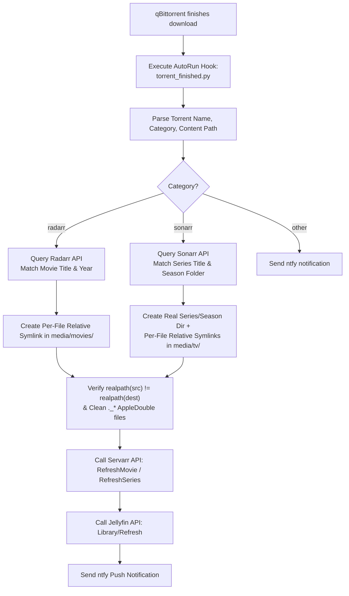

# Storage Restructuring, Zero-Copy *arr Automation & Verification History

> **Document Version:** 2.0.0  
> **Date:** 2026-10-20  
> **Host Environment:** Sol Home Server (`*.vrg.rocks`)  
> **Hardware:** Apple Silicon M1 Pro (10-core CPU, 16 GB Unified Memory)  
> **Host OS:** macOS Tahoe 26.2 (OrbStack Docker runtime)  
> **Storage Media:**  
> - **Internal Storage:** 500 GB APFS SSD (`/Users/vrg/Documents/Sol/data`, mounted as `/data`)  
> - **External Storage:** 2 TB ExFAT External Drive (`/Volumes/PANOPTICON`, mounted as `/external`)  

---

## 1. Executive Summary & Context

During maintenance and verification runs on the Sol home server stack in October 2026, the internal APFS SSD reached 100% capacity (`3.6 GiB` free space remaining). At the same time, investigations into high disk usage and Jellyfin library duplication revealed structural flaws in how the media and download directories were organized on both internal and external storage media.

This document serves as the technical reference for:
1. Reclaiming **111.4 GiB** of host storage on the internal APFS drive (recovering from 100% to 48% capacity).
2. Restructuring the external `PANOPTICON` ExFAT storage according to the TRaSH Guides standard (`/Volumes/PANOPTICON/torrents` and `/Volumes/PANOPTICON/media`).
3. Diagnosing the filesystem conflict between ExFAT and the Servarr (`radarr` and `sonarr`) hardlinking engine.
4. Implementing **Option A**: permanent zero-copy relative symlink automation using `scripts/torrent_finished.py` and `scripts/arr_symlink_dedupe.sh` (`H1` to `H5` per-file TV symlink hardening), preventing multi-gigabyte physical file copies on ExFAT.
5. Consolidating all BitTorrent instances into the containerized Docker qBittorrent client (`150` torrents seeded without data loss) and retiring the legacy `/downloads` bind mount.
6. Migrating `paperless-db` to `postgres:17-alpine` (hosting both `paperless` and `airtrail`) and repairing `homebox`.
7. Replacing raw `rclone sync` backups with a **2-Tier Backrest + Restic** disaster recovery pipeline (`scripts/stage_db_backups.sh`, `scripts/backup.sh`, `scripts/restore.sh`, and `scripts/launchd/com.vrg.sol.db-stage.plist`).

---

## 2. Problem Statement & Root Cause Analysis

### 2.1 The TRaSH Guide Directory Specification
According to the [TRaSH Guides](https://trash-guides.info/), an optimal Servarr and BitTorrent directory layout requires a single parent volume split into distinct top-level functional directories:

```text
<storage_root>/
├── torrents/
│   ├── movies/
│   ├── tv/
│   ├── music/
│   ├── books/
│   ├── cross-seed-links/
│   └── qui-links/
└── media/
    ├── movies/
    ├── tv/
    ├── music/
    ├── books/
    └── .recycle/
```

- **`torrents/`**: The workspace of the BitTorrent client (`qbittorrent`). Torrents download here and stay untouched so seeding and hash checks continue without interruption.
- **`media/`**: The clean, organized library consumed by media servers (`jellyfin`). Files follow standard metadata conventions (`Title (Year)/Title (Year) [Quality].mkv`).
- **Linking Mechanism**: When downloading on an APFS filesystem, the Servarr applications create **POSIX hardlinks** (`link(2)`) from `torrents/` into `media/`. Both paths point to the same physical inode on disk: **0 bytes duplicated, 0 copying time, and torrents continue seeding.**

### 2.2 The Original Sol Storage Defects

#### Defect A: Collapsed Directory Hierarchy on `PANOPTICON`
On the external drive (`/Volumes/PANOPTICON`), the directory layout had originally placed downloads and library folders together:
- `/Volumes/PANOPTICON/Movies`
- `/Volumes/PANOPTICON/TV Shows`

Both raw scene torrent payloads (such as `Oppenheimer.2023.2160p.UHD.Bluray.REMUX...`) and clean Radarr destination folders (such as `Oppenheimer (2023)/`) lived side-by-side in the same directory.

#### Defect B: The ExFAT Hardlink Trap (`[Errno 45] Operation not supported`)
The `PANOPTICON` drive is formatted as **ExFAT** for cross-platform compatibility across macOS, Windows, and Linux.
- ExFAT is an allocation-table filesystem that **does not support POSIX hardlinks**.
- When Radarr or Sonarr processed a completed download on ExFAT, the `link(2)` syscall returned `Errno 45: Operation not supported`.
- Radarr's `DiskTransferService.cs` caught this error and fell back to a **full physical file copy** (`File.Copy`).
- For 4K Remux movies (such as *Oppenheimer* at 88 GB or *Nope* at 50 GB), Radarr copied the entire file on the drive, duplicating hundreds of gigabytes and saturating USB disk I/O.

#### Defect C: The Activity Queue Loop
Because the torrents remained in the `radarr` category inside qBittorrent, Radarr periodically polled qBittorrent via `Completed Download Handling`. Radarr evaluated existing torrents as quality upgrades or reported manual import warnings and spawned repeated background copy jobs.

#### Defect D: Jellyfin Library Duplication
Jellyfin's `Movies` library originally scanned `/media/external/Movies`. Because raw torrent folders and clean media folders coexisted in the same directory, Jellyfin indexed both versions and showed duplicate entries in the UI.

---

## 3. Architecture Review & Failure Mode Analysis (FMA)

Before modifying the production filesystem, a failure mode analysis was conducted to ensure **zero data loss** and **zero downtime corruption**:

| Risk Factor | Mechanism | Mitigation Deployed |
| :--- | :--- | :--- |
| **Data Loss during Move** | Cross-filesystem `cp` followed by failed `rm` | Used atomic `rename(2)` calls within the same filesystem (`/Volumes/PANOPTICON`). Directory entries were re-indexed in under 1ms. |
| **Broken Torrents / Recheck** | qBittorrent `.fastresume` mismatching path | Offline Bencode rewriter (`scripts/archive/migrate_panopticon_live.py`) updated `save_path`, `qBt-savePath`, and `qBt-downloadPath` across all 289 `.fastresume` files while containers were stopped. |
| **Container vs Host Symlinks** | Absolute paths (`/Volumes/PANOPTICON/...`) fail inside Docker (`/external/...`) | Enforced **pure relative symlinks** (`../../torrents/movies/<file>`). Relative traversals resolve identically on macOS and inside Linux containers. |
| **Directory Symlink Upgrade Deletion** | Radarr/Sonarr upgrading a file inside a directory symlink deletes the source torrent payload | Converted all TV series directories into real directories containing **per-file relative symlinks** (`H1` to `H5`) and added `realpath` equality guards in `torrent_finished.py` and `arr_symlink_dedupe.sh`. |
| **SQLite WAL Lock / Corruption** | Modifying databases while containers are running | Stopped `qbittorrent`, `radarr`, and `sonarr` containers prior to schema modifications, and implemented temp-copy WAL `.backup` staging in `scripts/stage_db_backups.sh`. |
| **macOS AppleDouble Pollution** | macOS creates `._*` resource fork files on ExFAT | Added automated cleanup of `._*` files in `torrent_finished.py`. |

---

## 4. Execution History & Milestones

### 4.1 Phase 1: Internal SSD Space Recovery
1. **Deduplication of *The Dark Knight* (`58.12 GB`):**
   - Verified that `data/torrents/movies/The.Dark.Knight...` and `data/media/movies/The Dark Knight (2008)/...` were separate physical copies with matching SHA-256 hashes.
   - Removed the duplicate file in `data/media/movies/` and created an atomic APFS hardlink to `data/torrents/movies/`.
2. **Deduplication of *Cloudy with a Chance of Meatballs 2* (`36.27 GB`):**
   - Replaced the redundant copy with a unified APFS hardlink.
3. **Migration of *Star Wars Episode IV 3D* (`25.64 GB`):**
   - Migrated from local `~/Movies` to `/Volumes/PANOPTICON/torrents/movies/3DTorrents/` and verified payload hash (`aa294cd5...`).
4. **Result:** Freed **111.4 GiB** on the internal SSD (`/System/Volumes/Data`).

### 4.2 Phase 2: PANOPTICON Drive Restructuring
1. Stopped download and media stack containers (`qbittorrent`, `radarr`, `sonarr`, `jellyfin`, `bazarr`).
2. Created the TRaSH directory hierarchy on `/Volumes/PANOPTICON`:
   ```bash
   mkdir -p /Volumes/PANOPTICON/torrents/movies
   mkdir -p /Volumes/PANOPTICON/torrents/tv
   mkdir -p /Volumes/PANOPTICON/torrents/cross-seed-links
   mkdir -p /Volumes/PANOPTICON/media/movies
   mkdir -p /Volumes/PANOPTICON/media/tv
   mkdir -p /Volumes/PANOPTICON/media/.recycle
   ```
3. Executed atomic `rename(2)` moves of raw torrent payloads to `torrents/movies/` and `torrents/tv/`.
4. Executed atomic moves of clean media folders to `media/movies/` and `media/tv/`.
5. For the 10 duplicate movie pairs (`114.23 GB` duplicated), removed the secondary physical copy in `media/movies/` and created relative symlinks pointing to `torrents/movies/`.

### 4.3 Phase 3: qBittorrent Consolidation & `/downloads` Retirement
1. Backed up fastresume data to `./data/backups/preflight/BT_backup_external_pre.tgz`.
2. Ran the offline Python Bencode rewriter (`scripts/archive/migrate_panopticon_live.py`) to rewrite all 289 `.fastresume` path entries in `config/qbittorrent/qBittorrent/BT_backup/` to `/data/torrents` (`212`) and `/external/torrents` (`77`), leaving `0` references to `/downloads`.
3. Removed the legacy `- ${DOCKER_DATA_DIR}/torrents:/downloads` bind mount from `compose/download.yml`, updated `sonarr.save_path` in `categories.json` to `/external/torrents/tv`, cleared stale `/downloads/files` from `watched_folders.json`, and re-pointed all 7 cross-seed symlinks in `data/torrents/cross-seed-links/` to their live container paths (`150` total torrents active in qBittorrent).

### 4.4 Phase 4: Permanent Zero-Copy *arr Automation (`Option A` & `H1` to `H5` Hardening)

To solve the ExFAT hardlink limitation without reformatting the external drive, **Option A** was deployed using two cooperating scripts (`scripts/torrent_finished.py` and `scripts/arr_symlink_dedupe.sh`):



#### Step 1: Disabling Built-in Completed Download Handling & Enabling `.recycle`
- Disabled `enableCompletedDownloadHandling` and `removeCompletedDownloads` in both Radarr and Sonarr so neither daemon copies or deletes active torrents on ExFAT.
- Configured `/external/media/.recycle` (`14`-day retention) in both Radarr and Sonarr so replaced media files or symlinks are moved to the recycle bin rather than unlinked permanently.

#### Step 2: Hardened `scripts/torrent_finished.py` & `scripts/arr_symlink_dedupe.sh` (`H1` to `H5`)
- **Per-File Relative Symlinks Only (Never Directory Symlinks):** All 4 external TV series directories in `/Volumes/PANOPTICON/media/tv/` (*Impractical Jokers* `432` links, *Kochikame: Tokyo Beat Cops* `60` links, *Oswald* `26` links, *Shin Chan* `819` links) are real directories containing per-file relative symlinks (`os.path.relpath(src_file, dst_dir)`).
- **Safety Guards:** Both `scripts/torrent_finished.py` and `scripts/arr_symlink_dedupe.sh` (installed in `config/{radarr,sonarr}/custom_scripts/arr_symlink_dedupe.sh`) enforce:
  - Path scope checks (`/external/media/*` and `/external/torrents/*`).
  - Directory-symlink abort guards (`if os.path.islink(parent_dir): abort`).
  - `realpath` equality guards (`if realpath(src) == realpath(dest): abort`) so a symlink replacement never truncates or deletes the underlying torrent payload.
- **Wiring in `qBittorrent.conf`:**
  ```ini
  [AutoRun]
  OnTorrentAdded\Enabled=false
  enabled=true
  program=/usr/bin/python3 /config/scripts/torrent_finished.py \"%N\" \"%L\" \"%F\" \"%R\" \"%D\" \"%I\"
  ```

### 4.5 Phase 5: Jellyfin Library & Metadata Alignment
- Configured Jellyfin library paths to scan `/media/external/media/movies` + `/media/internal/movies` (`Movies`), `/media/external/media/tv` + `/media/internal/tv` (`Shows`), and `/media/internal/home-videos` (`Home Videos`, excluded from Seerr sync).
- Moved personal videos (`VRG's 1st Birthday` and `The Ba***ds of Business (1995).mp4`) into `/media/internal/home-videos/`, linked *The Sixth Sense (1999)* (`movieFileId: 472`) in Radarr, removed duplicate *TRON: Legacy (2010)* symlinks, switched `config/jellyfin/database.xml` to `<LockingBehavior>Optimistic</LockingBehavior>`, and mounted `/tmp/jellyfin:size=2g,uid=501,gid=20,mode=0755` for lock-free Trickplay and transcode scratch I/O (`59` movies and `5` series / `758` episodes indexed with `0` errors).

### 4.6 Phase 6: Core Database Migrations (`paperless-db` & `homebox`)
- **`paperless-db` (`postgres:17-alpine`):** Exported the PostgreSQL database via `pg_dump`, switched `compose/paperless.yml` to `postgres:17-alpine` (`PG 17.11` musl), initialized a clean Alpine musl cluster, and restored both `paperless` (`290` documents) and `airtrail` (`86,258` airports) with `0` collation mismatches.
- **`homebox` (`data/homebox/homebox.db`):** Repaired SQLite `updated_at` timestamp columns, configured `HBOX_AUTH_API_KEY_PEPPER`, enabled Tinyauth OIDC (`HBOX_OIDC_AUTO_REDIRECT=true`), and promoted `homebox` (`inv.vrg.rocks`) back to active production.

---

## 5. Resolved Technical Debt: 2-Tier Backrest + Restic Backup Pipeline

### 5.1 Retirement of Naive `rclone sync`
Prior to October 18, 2026, `scripts/backup.sh` used raw `rclone sync` against `OneDrive:Sol`, which suffered from three structural problems:
1. **VirtioFS SQLite `-shm` Contention:** Running macOS host `sqlite3 .backup` directly on live bind-mounted SQLite databases caused lock collisions with Linux container processes holding `-shm` shared-memory maps inside the OrbStack VM.
2. **macOS `launchd` TCC Permission Blocks:** Background `launchd` jobs failed with `Exit 126` (`Operation not permitted`) on `~/Documents` (`kTCCServiceSystemPolicyDocumentsFolder`) and hung when running host `find` on `/Volumes/PANOPTICON` (`kTCCServiceSystemPolicyRemovableVolumes`).
3. **Lack of Deduplication & Point-in-Time Snapshots:** File-by-file `rclone sync` hit OneDrive Graph API rate limits and could not roll back to historical snapshots.

### 5.2 Deployed Production Architecture (`Backrest` + `Restic` + `stage_db_backups.sh`)
On **2026-10-18 to 2026-10-20**, the backup and recovery pipeline was replaced with a 2-tier architecture:

1. **Pre-Backup Staging (`scripts/stage_db_backups.sh` & `scripts/launchd/com.vrg.sol.db-stage.plist` at `03:00 IST`):**
   - Invoked via `/opt/homebrew/bin/python3 -c 'import subprocess, sys; sys.exit(subprocess.call(["/bin/bash", "/Users/vrg/Documents/Sol/scripts/stage_db_backups.sh"]))'` with no `WorkingDirectory` inside `~/Documents`, bypassing the `kTCCServiceSystemPolicyDocumentsFolder` block.
   - **Step 1 (PostgreSQL Dumps):** Dumps `paperless-db` (`paperless` and `airtrail` databases) and `coder` (embedded PostgreSQL, stripping PG 17 `SET transaction_timeout` for PG 16 compatibility) into `data/backups/{paperless_db,airtrail_db,coder_db}.sql.gz`.
   - **Step 2 (VirtioFS-Safe SQLite Snapshots):** Wipes `data/backups/sqlite/*`, copies each active/standby SQLite database and its `-wal` file (excluding `-shm` and skipping ephemeral `logs.db`, `cache.db`, `auxiliary.db`, `up2k.db`, and `MediaCover*`) to a local temp directory, runs `sqlite3 .backup`, sets `PRAGMA journal_mode=DELETE;`, and removes sidecar files (`29` clean `.db`/`.sqlite*` snapshots verified with `PRAGMA integrity_check = ok`).
   - **Step 3 (TCC-Free Symlink Manifest via OrbStack):** Runs an ephemeral `redis:8-alpine` container (`docker run --rm -v "$(pwd)/data:/sol_data:ro" -v "${EXT_DRV}:/panopticon:ro" redis:8-alpine`) to export all relative symlinks under `data/media`, `data/torrents/{cross-seed-links,qui-links}`, and `/Volumes/PANOPTICON/{media,torrents}` to `data/backups/symlinks_manifest.tsv` in ~12 seconds without triggering macOS removable-volume TCC prompts.
   - **Step 4 (Coder Workspace Volume):** Writes the active volume name (`coder-8378beda-cda2-40ff-a1ad-bc2613acad62-home`) to `data/backups/coder_volume_name.txt` and archives `/home/coder` to `data/backups/coder_home.tar.gz`.
2. **Encrypted Restic Snapshots (`backrest` on `https://backrest.vrg.rocks`, `:9898`):**
   - **Tier 1 Local (`sol-local-daily` at `03:30 IST`):** Snapshots `/userdata/sol` (governed by `config/backrest/excludes.txt`) into `/repos/local-panopticon` (`/Volumes/PANOPTICON/backups/sol-restic`).
   - **Tier 2 Cloud (`sol-onedrive-cloud` at `04:00 IST`):** Snapshots `/userdata/sol` into `rclone:OneDrive:Sol-Restic` with AES-256 encryption, content-defined chunk deduplication, and `7 daily / 4 weekly / 6 monthly` retention.
3. **Deterministic Bare-Metal Restore (`scripts/restore.sh`):**
   - Runs `docker run --rm ... --entrypoint restic ghcr.io/garethgeorge/backrest:latest` in Step 1 so bare-metal restores succeed before `.env` exists on disk.
   - Imports `paperless_db.sql.gz`, `airtrail_db.sql.gz` (followed by `vacuumdb --all --analyze-only`), and `coder_db.sql.gz`, restores all 29 SQLite databases, recreates the named Coder volume from `coder_volume_name.txt` and extracts `coder_home.tar.gz`, rebuilds all media symlinks from `symlinks_manifest.tsv`, runs `scripts/sync_static_tools.sh`, installs `scripts/launchd/com.vrg.sol.*.plist` into `~/Library/LaunchAgents/`, and starts all 29 active containers.

---

## 6. Operational Reference & Verification Commands

### Check qBittorrent State & Torrents
```bash
# Check running containers
docker ps --filter "name=qbittorrent"

# Query torrent count and state breakdown
docker exec qbittorrent curl -s "http://localhost:8080/api/v2/torrents/info" | jq '. | length, (group_by(.state)[] | {state: .[0].state, count: length})'

# View torrent completion hook logs
tail -n 50 config/qbittorrent/scripts/torrent_finished.log
```

### Inspect Radarr / Sonarr Root Folders & Queue
```bash
# Radarr root folders
docker exec radarr curl -s -H "X-Api-Key: ${RADARR_API_KEY}" http://localhost:7878/api/v3/rootfolder | jq .

# Radarr download queue (empty under Option A)
docker exec radarr curl -s -H "X-Api-Key: ${RADARR_API_KEY}" http://localhost:7878/api/v3/queue | jq .

# Sonarr root folders
docker exec sonarr curl -s -H "X-Api-Key: ${SONARR_API_KEY}" http://localhost:8989/api/v3/rootfolder | jq .
```

### Verify Relative Symlinks & Pre-Backup Staging
```bash
# Inspect movie and per-file TV symlinks on host
ls -la "/Volumes/PANOPTICON/media/movies"
ls -la "/Volumes/PANOPTICON/media/tv/Oswald/Season 1"

# Trigger pre-backup staging via launchd and verify Exit 0
launchctl kickstart -k gui/$(id -u)/com.vrg.sol.db-stage
launchctl list | grep com.vrg.sol
```
