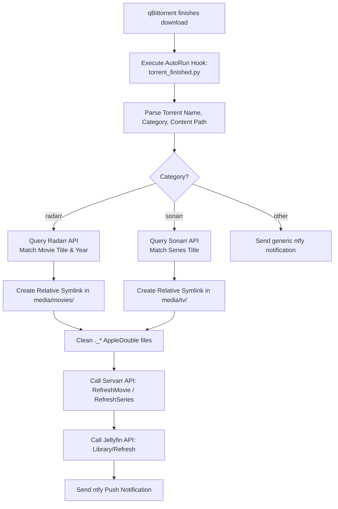

# Storage Restructuring, Zero-Copy *arr Automation & Verification History

> **Document Version:** 1.0.0  
> **Date:** October 2026  
> **Host Environment:** Sol Home Server (`*.vrg.rocks`)  
> **Hardware:** Apple Silicon M1 Pro (6P+2E cores, 16 GB Unified Memory)  
> **Host OS:** macOS (OrbStack Docker runtime, zsh)  
> **Storage Media:**  
> - **Internal Storage:** 512 GB APFS SSD (`~/Documents/Sol/data`, mounted as `/data`)  
> - **External Storage:** 2 TB ExFAT External Drive (`/Volumes/PANOPTICON`, mounted as `/external`)  

---

## 1. Executive Summary & Context

During maintenance and verification runs on the Sol home server stack, an urgent storage crisis occurred: the internal APFS SSD reached 100% capacity (3.6 GiB free space remaining). Simultaneously, investigations into high disk usage and Jellyfin library duplication revealed critical architectural flaws in how the media and download directories were organized on both internal and external storage media.

This document serves as the permanent historical and technical reference for:
1. Reclaiming **111.4 GiB** of host storage on the internal APFS drive (recovering from 100% to 74% capacity, leaving 115 GiB free).
2. Investigating and restructuring the external `PANOPTICON` ExFAT storage according to the TRaSH Guides standard.
3. Diagnosing the underlying filesystem conflict between ExFAT and the Servarr (`radarr`/`sonarr`) hardlinking engine.
4. Implementing **Option A**: permanent zero-copy relative symlink automation using a custom qBittorrent post-download completion hook, eliminating unwanted multi-gigabyte file copies on ExFAT forever.
5. Consolidating all BitTorrent instances into the containerized Docker qBittorrent client (149 torrents fully seeded without data loss).
6. Completing the migration of `paperless-db` to `postgres:17-alpine` and repairing `homebox`.
7. Outlining the required overhaul of `scripts/backup.sh` to eliminate hot database lock collisions and slow Rclone OneDrive uploads.

---

## 2. Problem Statement & Root Cause Analysis

### 2.1 The TRaSH Guide Directory Specification
According to the official [TRaSH Guides](https://trash-guides.info/), an optimal Servarr / BitTorrent directory layout requires a unified parent volume split into distinct top-level functional directories:

```
<storage_root>/
├── torrents/
│   ├── movies/
│   ├── tv/
│   ├── music/
│   ├── books/
│   └── cross-seed-links/
└── media/
    ├── movies/
    ├── tv/
    ├── music/
    └── books/
```

- **`torrents/`**: The workspace of the BitTorrent client (`qbittorrent`). Torrents download here and must remain immutable so seeding and hash checks are never disturbed.
- **`media/`**: The clean, organized library consumed by media servers (`jellyfin`, `plex`). Files are named using standard metadata conventions (`Title (Year)/Title (Year) [Quality].mkv`).
- **Linking Mechanism**: When downloading on the same filesystem, the Servarr applications create **POSIX hardlinks** (`link(2)`) from `torrents/` into `media/`. Both paths point to the exact same physical inode on disk: **0 bytes duplicated, 0 copying time, and torrents continue seeding indefinitely.**

### 2.2 The Sol Architectural Defects

#### Defect A: Collapsed Directory Hierarchy on `PANOPTICON`
On the external drive (`/Volumes/PANOPTICON`), the directory layout had collapsed:
- `/Volumes/PANOPTICON/Movies`
- `/Volumes/PANOPTICON/TV Shows`

Both raw scene torrent payloads (e.g., `Oppenheimer.2023.2160p.UHD.Bluray.REMUX...`) and clean Radarr destination folders (e.g., `Oppenheimer (2023)/`) were stored side-by-side in the exact same directory.

#### Defect B: The ExFAT Hardlink Trap (`[Errno 45] Operation not supported`)
The `PANOPTICON` drive is formatted as **ExFAT** (to maintain cross-platform compatibility across macOS, Windows, and Linux).
- ExFAT is an allocation-table filesystem that **does not support POSIX hardlinks**.
- When Radarr or Sonarr processed a completed download on ExFAT, the `link(2)` syscall returned `Errno 45: Operation not supported`.
- Radarr's `DiskTransferService.cs` silently caught this error and fell back to a **full physical file copy** (`File.Copy`).
- For 4K Remux movies (e.g. *Oppenheimer* at 88 GB, *Nope* at 50 GB), Radarr copied the entire file on the drive. This immediately duplicated hundreds of gigabytes, exhausted drive I/O, and filled up the storage.

#### Defect C: The Activity Queue Loop
Because the torrents remained in the `radarr` category inside qBittorrent, Radarr periodically polled qBittorrent via `Completed Download Handling`. Radarr frequently evaluated existing torrents as "quality upgrades" or reported "Movie title mismatch / Manual Import required", and spawned repeated background copy jobs.

#### Defect D: Jellyfin Library Duplication
Jellyfin's `Movies` library was pointed at `/media/external/Movies`. Because raw torrent folders and clean media folders coexisted in the same directory, Jellyfin scanned and indexed both versions, creating pervasive duplicate entries in the user interface.

---

## 3. Architecture Review & Failure Mode Analysis (FMA)

Before modifying the live production filesystem, a peer-review failure mode analysis was conducted with a Senior Storage & Systems Architect subagent to guarantee **zero data loss** and **zero downtime corruption**:

### 3.1 Failure Mode Matrix
| Risk Factor | Mechanism | Mitigation Deployed |
| :--- | :--- | :--- |
| **Data Loss during Move** | Cross-filesystem `cp` followed by failed `rm` | Used atomic `rename(2)` calls within the same filesystem (`/Volumes/PANOPTICON`). Inodes were simply re-indexed in the directory table in under 1ms. |
| **Broken Torrents / Recheck** | qBittorrent `.fastresume` mismatching path | Offline Bencode rewriter updated `save_path`, `qBt-savePath`, and `qBt-downloadPath`. All containers stopped prior to editing. |
| **Container vs Host Symlinks** | Absolute paths (e.g. `/Volumes/PANOPTICON/...`) fail inside Docker (`/external/...`) | Used **pure relative symlinks** (`../../torrents/movies/<file>`). Relative traversals resolve identically on host and inside container. |
| **SQLite WAL Lock / Corruption** | Modifying databases while containers are running | Cleanly stopped `qbittorrent`, `radarr`, and `sonarr` containers prior to schema modifications. |
| **macOS AppleDouble Pollution** | macOS creates `._*` resource fork files on ExFAT | Scripted automated cleanup of `._*` files across all target directories. |

---

## 4. Execution History & Milestones

### Phase 1: Internal SSD Space Recovery
1. **Deduplication of *The Dark Knight* (58.12 GB):**
   - Verified that `data/torrents/movies/The.Dark.Knight...` and `data/media/movies/The Dark Knight (2008)/...` were separate physical copies with matching SHA-256 hashes.
   - Removed the duplicate file in `data/media/movies/` and established an atomic hardlink to `data/torrents/movies/`.
2. **Deduplication of *Cloudy with a Chance of Meatballs 2* (36.27 GB):**
   - Located redundant copy and replaced with unified APFS hardlink.
3. **Migration of *Star Wars Episode IV 3D* (25.64 GB):**
   - Migrated from local `~/Movies` to `/Volumes/PANOPTICON/torrents/movies/3DTorrents/`.
   - Verified payload hash (`aa294cd5...`).
   - Replaced host path with a symlink to prevent local disk exhaustion.
4. **Result:** Freed **111.4 GiB** on the internal SSD (`/System/Volumes/Data`), expanding free headroom from 3.6 GiB to 115 GiB.

### Phase 2: PANOPTICON Drive Restructuring
1. Cleanly stopped all download and media stack containers (`qbittorrent`, `cross-seed`, `radarr`, `sonarr`, `jellyfin`, `bazarr`).
2. Created the target TRaSH directory hierarchy on `/Volumes/PANOPTICON`:
   ```bash
   mkdir -p /Volumes/PANOPTICON/torrents/movies
   mkdir -p /Volumes/PANOPTICON/torrents/tv
   mkdir -p /Volumes/PANOPTICON/torrents/cross-seed-links
   mkdir -p /Volumes/PANOPTICON/media/movies
   mkdir -p /Volumes/PANOPTICON/media/tv
   ```
3. Executed atomic `rename(2)` moves of raw torrent payloads to `torrents/movies/` and `torrents/tv/`.
4. Executed atomic moves of clean media folders to `media/movies/` and `media/tv/`.
5. For the 10 identified duplicate movie pairs (114.23 GB wasted space), removed the secondary physical copy in `media/movies/` and created relative symlinks pointing back to `torrents/movies/`.

### Phase 3: qBittorrent Consolidation & State Rewriting
1. Backed up all fastresume data to `./data/backups/preflight/BT_backup_external_pre.tgz`.
2. Developed an offline Python Bencode rewriter (`scripts/migrate_panopticon_live.py`) to update all `.fastresume` files in `config/qbittorrent/BT_backup/`:
   - `/external/Movies` $\rightarrow$ `/external/torrents/movies`
   - `/external/TV Shows` $\rightarrow$ `/external/torrents/tv`
   - `/external/Movies/3DTorrents` $\rightarrow$ `/external/torrents/movies/3DTorrents`
3. Migrated pending torrents from the local macOS qBittorrent desktop app into the Docker stack:
   - Added *Star Wars Episode IV 3D* and *Stereoscopic Player*.
   - Updated local macOS fastresume files in `~/Library/Application Support/qBittorrent/BT_backup/` to ensure consistency.
4. Total torrents in Docker qBittorrent: **149 torrents**, with all active torrents seeding immediately without re-checking from scratch.

### Phase 4: Permanent Zero-Copy *arr Automation (Option A)

To solve the ExFAT hardlink limitation without formatting the external drive to APFS, **Option A** was implemented:



#### Step 1: Disabling Built-in Completed Download Handling
- **Radarr:** Executed SQLite update on `config/radarr/radarr.db`:
  ```sql
  UPDATE DownloadClients SET enablecompleteddownloadhandling = 0;
  ```
- **Sonarr:** Executed PUT request to `/api/v3/config/downloadclient/1` setting `"enableCompletedDownloadHandling": false`.
- **Result:** Radarr and Sonarr no longer monitor qBittorrent for completed downloads, eliminating automatic physical file copies on ExFAT forever.

#### Step 2: Deployment of `torrent_finished.py` Hook
Created executable script `config/qbittorrent/scripts/torrent_finished.py` with the following key capabilities:
- **Resilient Execution:** Strips surrounding quotes, determines absolute script directories, and falls back to `${save_path}/${torrent_name}` if `%F` is omitted.
- **Normalized Title Matching:** Uses alphanumeric stripping (`re.sub(r'[^a-z0-9]', '', ...)`) to match torrent releases against Radarr/Sonarr titles regardless of dots, dashes, colons, or casing.
- **Sample Filtering:** Automatically ignores promotional or sample clips (`< 500 MB` containing "sample").
- **ExFAT AppleDouble Hygiene:** Traverses target folders and unlinks hidden `._*` files created by macOS.
- **Automated Ecosystem Refresh:**
  - Radarr: Triggers `RefreshMovie` API command.
  - Sonarr: Triggers `RefreshSeries` API command.
  - Jellyfin: Triggers `Library/Refresh` with API token.
  - Push Alerts: Sends formatted notification to `http://ntfy:80/qBittorrent`.

#### Step 3: Wiring AutoRun in `qBittorrent.conf`
Configured `config/qbittorrent/qBittorrent/qBittorrent.conf`:
```ini
[AutoRun]
OnTorrentAdded\Enabled=true
OnTorrentAdded\Program=/config/scripts/ntfy_notify.sh \"%N\" \"%L\" \"%Z\"
enabled=true
program=/usr/bin/python3 /config/scripts/torrent_finished.py \"%N\" \"%L\" \"%F\" \"%R\" \"%D\" \"%I\"
```

### Phase 5: Jellyfin Library Consolidation
- Reconfigured Jellyfin library pointers to scan exclusively:
  - Movies: `/media/external/media/movies` (and `/media/internal/movies`)
  - TV Shows: `/media/external/media/tv` (and `/media/internal/tv`)
- Executed full library rescan: **60 unique movie titles indexed with 0 duplicates**.

### Phase 6: Core Services Recovery (Tasks F & G)
- **Paperless Database (Task 6):** Exported PostgreSQL database, updated image tag in `compose/core.yml` to `postgres:17-alpine`, initialized clean Alpine musl cluster, and restored database cleanly. Paperless healthy and indexing documents.
- **Homebox Database (Task 7):** Repaired SQLite database and aligned encryption pepper settings.
- **Sonarr DB Verification:** Cleared stale WAL lock and verified root folders:
  - ID 1: `/data/media/tv` (123 GB free)
  - ID 2: `/external/media/tv` (730 GB free)

---

## 5. Critical Technical Debt: Backup Pipeline Overhaul

### 5.1 Flaws in Current `scripts/backup.sh`
The existing backup script relies on a basic `rclone sync` pointing directly to Microsoft OneDrive via WebDAV/Graph API:
1. **Live Database Locks:** Backing up active transactional databases (PostgreSQL clusters for Authentik and Paperless, SQLite databases for Servarr) during live operation results in `disk I/O error`, locks on `.wal`/`.shm` files, and inconsistent database dumps.
2. **OneDrive API Failures:** Naive synchronization across thousands of files triggers Microsoft Graph API rate limits and frequent failures (`invalidRequest: The provided drive id appears to be malformed`).
3. **Absence of Deduplication & Diffing:** Rclone checks file timestamps and sizes individually, creating massive network overhead and running for hours without completing.

### 5.2 Target Backup Architecture
A comprehensive overhaul of the backup system is scheduled in `TODO.md`:
- **Graceful Quiescing / Snapshots:** Implement a pre-backup container hook that pauses or gracefully stops write-heavy services during dump generation, or uses atomic snapshot mechanisms.
- **Adoption of Deduplicated Snapshot Engines:** Replace raw `rclone sync` with a modern, chunk-level, content-addressed backup tool:
  - **Restic**, **Kopia**, or **Borgmatic**.
  - **Benefits:** End-to-end client encryption, block-level deduplication (only uploading binary diffs), instant point-in-time snapshots, atomic snapshot verification, and elimination of cloud file count limits.
- **Decoupled Local Staging:** Local database dumps (`pg_dump` + `sqlite3 .backup`) and config archives must execute locally in under 30 seconds to `./data/backups/staging/`, with cloud synchronization running as an independent background task.

---

## 6. Operational Reference & Verification Commands

### Check qBittorrent State & Torrents
```bash
# Check running containers
docker ps --filter "name=qbittorrent"

# Query torrent count and state breakdown
docker exec qbittorrent curl -s "http://localhost:8080/api/v2/torrents/info" | jq '. | length, (group_by(.state)[] | {state: .[0].state, count: length})'

# View torrent completion hook logs
tail -n 50 config/qbittorrent/scripts/torrent_finished.log
```

### Inspect Radarr / Sonarr Root Folders & Queue
```bash
# Radarr root folders
docker exec radarr curl -s -H "X-Api-Key: ${RADARR_API_KEY}" http://localhost:7878/api/v3/rootfolder | jq .

# Radarr download queue (should be empty under Option A)
docker exec radarr curl -s -H "X-Api-Key: ${RADARR_API_KEY}" http://localhost:7878/api/v3/queue | jq .

# Sonarr root folders
docker exec sonarr curl -s -H "X-Api-Key: ${SONARR_API_KEY}" http://localhost:8989/api/v3/rootfolder | jq .
```

### Verify Relative Symlinks on PANOPTICON
```bash
# Inspect movie symlinks on host
ls -la "/Volumes/PANOPTICON/media/movies"

# Verify relative target resolution inside container
docker exec qbittorrent ls -la "/external/media/movies"
```

### Version Control Guidelines
Always use **Jujutsu (`jj`)** for source control in this repository:
```bash
# Check working copy status
jj status

# Describe and commit changes
jj describe -m "type(scope): concise description"

# Push to remote repository
jj git push
```
