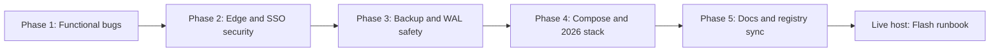
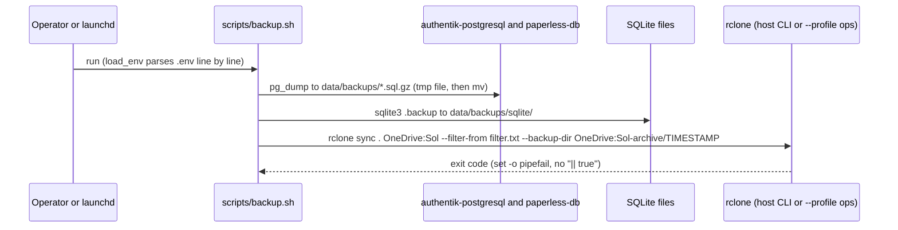

# 09. Architectural Audit and Upgrade Plan (October 2026)

> **Scope:** Cross-family `/double-agent` review of the Sol repository at commit `9b88941` (`feat(media): migrate Jellyseerr to Seerr v3.5.0`), the five implementation phases that followed, and the checks that still need the live host.
> **Reviewers:** Gemini 4 Argon (`gemini_debater`, `MODEL_PLACEHOLDER_M286`) and Claude Opus 5.5 High (`opus_debater`, `MODEL_PLACEHOLDER_M370`), with a separate arbiter agent.
> **Live-host follow-up:** [FLASH_LOCAL_VERIFICATION_RUNBOOK.md](../FLASH_LOCAL_VERIFICATION_RUNBOOK.md).

---

## 1. Review Method

1. Both debaters audited all 33 tracked files on their own, without seeing the other position.
2. One bounded cross-examination round followed. Each side marked every claim of the other side as AGREE or DISAGREE with file and line evidence.
3. The arbiter merged the two positions into one decision packet. Every citation in the packet was checked against disk (`check_packet.py` result `PACKET OK`).
4. The review had no access to the untracked `.env`, `config/`, `data/`, `web/`, `quartz/`, or `/Volumes/PANOPTICON`. Each claim that depends on those paths became an open live-host check (section 9).

### Outcome Summary

| Measure | Result |
| :--- | :--- |
| Unanimous action items | 21 |
| Evidence-backed decision forks | 1 (`paperless-db` glibc vs musl) |
| Live-host falsification checks | 4 (Paperless password, Authentik outpost, mobile qBittorrent client, `homebox` state) |
| Varun's answers | `homebox` to standby, `qb.vrg.rocks` keeps native auth (Android app), standby services to `profiles:`, Byparr swap and dual mount staging approved |

---

## 2. Phase 1: Functional Bug Fixes

| # | Finding at `9b88941` | Change | Rationale |
| :--- | :--- | :--- | :--- |
| 1.1 | `paperless-webserver` set only `PAPERLESS_DBHOST`. It never sent the DB user, password, or name, so Paperless used its built-in password `paperless` while `paperless-db` took `POSTGRES_PASSWORD: ${PAPERLESS_DB_PASS:-paperless}`. | Added `PAPERLESS_DBNAME: ${PAPERLESS_DB_NAME:-paperless}`, `PAPERLESS_DBUSER: ${PAPERLESS_DB_USER:-paperless}`, and `PAPERLESS_DBPASS: ${PAPERLESS_DB_PASS:-paperless}` to `compose/paperless.yml`. | A custom `PAPERLESS_DB_PASS` and the webserver now use one source. The `:-paperless` default stays, so a host whose role still uses `paperless` keeps working. The packet proposed `:?` (fail if unset). The `:-` fallback was kept until the live password check passes. |
| 1.1b | `PAPERLESS_WORKER_CONCURRENCY: 2` (not an upstream variable) and `PAPERLESS_OCR_THREADS: 2` (deprecated). | Removed both. Kept `PAPERLESS_TASK_WORKERS: 2` and added `PAPERLESS_THREADS_PER_WORKER: 2`. | Matches the upstream Paperless-ngx settings. The M1 Pro tuning now takes effect. |
| 1.2 | `AUTHENTIK_WORKERS: 2` on `authentik-server`. Authentik reads nested keys with a double underscore. | Replaced with `AUTHENTIK_WEB__WORKERS: 2`. | The old key did nothing. The new key sets the Gunicorn web workers. |
| 1.3 | `coder/main.tf` and `coder/default.tf` declared the same `terraform`, `provider`, `variable`, `data`, `module`, and `resource` blocks in one directory. | Deleted `coder/default.tf`. | Terraform loads every `.tf` file in a directory as one module. Duplicate blocks fail `terraform validate` and `coder templates push`. |
| 1.3b | `coder/main.tf` ran `cargo install jj-cli --locked` (plus `build-essential cargo`) on every new workspace. | Downloads the prebuilt `jj` `v0.28.2` musl release (`aarch64-unknown-linux-musl` or `x86_64-unknown-linux-musl`, chosen by `uname -m`) into `~/.local/bin`. The apt step now installs only `curl unzip git tar`. | Removes a Rust compile across all 8 cores from workspace startup. The review estimate was about 4 minutes down to about 2 seconds. |
| 1.4 | `scripts/setup_jellyfin_metal.py` ran `shutil.rmtree(CONFIG_DIR)` whenever `config/jellyfin_metal` existed. The README told the operator to start native Jellyfin with that script. | Added `argparse` with `--reset`. If `config/jellyfin_metal/data/jellyfin.db` exists and `--reset` is absent, the script only launches the process on `127.0.0.1:8097` and waits for `/System/Info/Public`. | A routine start no longer deletes users, API keys, and watch history. |
| 1.5 | `scripts/test_cross_seed.sh` ran `docker exec -u 0`, so it tested root instead of `PUID:PGID`, and it created root-owned `/external/cross-seed-links`. | Runs as `-u "${PUID:-501}:${PGID:-20}"`. Adds a `/data/torrents` to `/data/media` hardlink test. | The test now proves what the unprivileged `cross-seed` container can do, and it no longer causes ownership drift. |

---

## 3. Phase 2: Edge, SSO, and Container Security

| # | Finding | Change | Rationale |
| :--- | :--- | :--- | :--- |
| 2.1 | The `inv.vrg.rocks` vhost matched `Origin *` and reflected `{http.request.header.Origin}` with `Access-Control-Allow-Credentials true`. | The CORS matcher and the `OPTIONS` preflight now allow only `https://scan.vrg.rocks`. The whole vhost is commented out while `homebox` is on standby. | Any site opened in a logged-in browser could make credentialed requests. Only the barcode scanner PWA needs cross-origin access. |
| 2.2 | `code.vrg.rocks` (code-server mounts the whole repo, including `.env`, and `/Users/vrg/Documents` read-write) and `dash.vrg.rocks` (Glance holds the Docker socket) had no forward auth. | Added `import authentik` to both. | Both routes expose host-level data. Code-server keeps its own password as a second factor. |
| 2.2b | `qb.vrg.rocks` had no forward auth. | Kept without `import authentik`. The Caddyfile comment records why. | Varun's Android torrent client connects directly and cannot follow an SSO redirect. qBittorrent native auth stays the gate. Internal `*arr` and `cross-seed` traffic uses `http://qbittorrent:8080` on the bridge and never passes Caddy. |
| 2.3 | `authentik-server` published `9000` and `9443` on `0.0.0.0`, which bypassed Caddy on the LAN. | Bound to `127.0.0.1:${COMPOSE_PORT_HTTP:-9000}:9000` and `127.0.0.1:${COMPOSE_PORT_HTTPS:-9443}:9443`. | Edge and LAN traffic now enter only through Caddy at `auth.vrg.rocks`. Loopback stays open for host debugging. |
| 2.3b | `authentik-worker` ran as `user: root` with `/var/run/docker.sock` mounted. | Removed both. The worker keeps `/data`, `/certs`, and `/templates`. | Caddy uses the embedded outpost (`forward_auth authentik-server:9000`, `uri /outpost.goauthentik.io/auth/caddy`). No outpost needs Docker deployment, so root plus the socket was host-root exposure for no purpose. The live outpost check is in the runbook (Task 3). |
| 2.3c | `arcane` ran with `LOG_LEVEL: debug`. | `LOG_LEVEL: info`. | Debug logs wrote OIDC token and session detail. |
| 2.4 | 18 vhosts pointed to services that were not running (`status`, `kuma`, `beszel`, `dozzle`, `dockge`, `homarr`, `wizarr`, `qbm`, `flood`, `paperless-ai`, `leaf`, `kavita`, `calibre`, `calibre-web`, `inv`, `vault`, `n8n`, `rclone`). | Commented out under `--- Standby ... Routes (Uncomment when launching with --profile standby) ---` headers in each Caddyfile section. | Stops needless ACME certificate requests and `502` responses. Each block is ready to restore when its service starts. |

---

## 4. Phase 3: Backup, SQLite WAL Safety, and Disaster Recovery

| # | Finding | Change | Rationale |
| :--- | :--- | :--- | :--- |
| 3.1 | `scripts/restore.sh` printed that `authentik_db.sql.gz` and `paperless_db.sql.gz` existed but never imported them, although the README claimed it did. | Restores missing SQLite files from `data/backups/sqlite/` (`__` maps back to `/`). Imports each dump with `gunzip -c ... \| docker exec -i <db> psql` after `pg_isready`. Imports run when `--restore-dbs` is set, or with `--start-stack` when the cluster has no `PG_VERSION`. Also initializes `config/rclone/filter.txt` from the template. | A cold start on new hardware now restores both PostgreSQL clusters. |
| 3.2 | `scripts/backup.sh` did not load `.env`. | Loads `.env` with a line-by-line `load_env` parser and runs `set -euo pipefail`. | `PG_USER`, `PG_DB`, `PAPERLESS_DB_USER`, and `PAPERLESS_DB_NAME` now reach `pg_dump`. |
| 3.2b | `rclone sync ... \| tee -a "$LOG_FILE" \|\| true` swallowed every rclone failure and still printed success. | Removed `\|\| true`. `pipefail` returns the rclone exit code. | A failed upload is now a failed backup. |
| 3.2c | The fallback ran `docker compose run --rm rclone`, but the `rclone` service was commented out. | `rclone` is a real service on profiles `ops` and `standby`. The fallback runs `docker compose --profile ops run --rm rclone sync /source OneDrive:Sol ...`. | The container path works when no host `rclone` exists. |
| 3.2d | `rclone sync` replaced and deleted remote files with no history. | Added `--backup-dir "OneDrive:Sol-archive/${TIMESTAMP}"`. | Every replaced or deleted file is kept under a timestamped archive. |
| 3.2e | The filter shipped raw live PostgreSQL clusters and live SQLite `-wal`/`-shm` files. | New tracked `config/rclone/filter.txt.example` excludes `data/authentik/**`, `data/paperless/db/**`, `data/paperless/redis/**`, `**/*-wal`, and `**/*-shm`. `backup.sh` takes online `sqlite3 .backup` snapshots of every `*.db`, `*.sqlite`, and `*.sqlite3` under `./config`, `./data/arcane`, and `./data/ignis` (`-maxdepth 4`) before the sync. `.gitignore` now ignores `/config/*` except `config/rclone/filter.txt.example`. | A copied live cluster or a `.db` file without its WAL is not a consistent backup. Logical dumps and atomic snapshots are. |
| 3.3 | Found during the doc pass: the old `.env.example` line `PAPERLESS_OCR_LANGUAGES=hin kan pan` made `source ./.env` under `set -euo pipefail` exit with `kan: command not found` (exit `127`, reproduced in a clean shell). | `.env.example` now quotes `PAPERLESS_OCR_LANGUAGES="hin kan pan"` and single-quotes `PAPERLESS_SOCIALACCOUNT_PROVIDERS='...'`. `backup.sh` and `restore.sh` use `load_env`. `test_cross_seed.sh` reads only `PUID` and `PGID` with the same parser. | All three scripts would have aborted before their first step on any host that copied the template. |
| 3.4 | Found during the doc pass: macOS `/bin/bash` is 3.2, which treats an empty `"${arr[@]}"` as unbound under `set -u`. | `restore.sh` uses `${DRY_RUN_ARG[@]+"${DRY_RUN_ARG[@]}"}` and `${RCLONE_CONF_ARG[@]+"${RCLONE_CONF_ARG[@]}"}`. | Without the guard, every non-dry-run restore would fail at `rclone copy`. Not reproduced on bash 3.2 during the review. The runbook (Task 1.2) checks it on the host. |

---

## 5. Phase 4: Compose Modernization and 2026 Stack Changes

| # | Change | Rationale |
| :--- | :--- | :--- |
| 4.1 | Every commented-out service became a real service with `profiles: ["standby"]`, and `rclone` uses `profiles: ["ops", "standby"]`. Plain `docker compose up -d` starts 24 containers. Start one standby service with `docker compose --profile standby up -d <service>`. | Commented YAML is never validated and drifts. Profiles keep all 50 definitions under `docker compose config`. |
| 4.2 | `.env` driven tags: `caddy:${CADDY_TAG:-2}`, `paperless-ngx:${PAPERLESS_TAG:-2}`, `arcane:${ARCANE_TAG:-latest}`, `coder:${CODER_TAG:-latest}`. Authentik stays on `${AUTHENTIK_IMAGE}:${AUTHENTIK_TAG:-2026.5.3}`. `paperless-broker` moved to `redis:8-alpine`. Stateless images stay on `:latest`. | Caddy and Paperless now follow one major version. Arcane and Coder can be pinned from `.env` without a compose edit. The packet's example minor pins (`2.9`, `2.14`, `v0.10`, `v2.21.0`) were not used, because the running versions on the host were unknown. |
| 4.3 | `glance` uses `TZ: ${TZ:-Asia/Kolkata}` plus `/etc/localtime:ro` instead of `/etc/timezone:ro`. Linux SELinux `:z` suffixes were removed from `compose/utilities.yml`. | macOS has no `/etc/timezone`, so Docker created an empty directory there. `:z` does nothing on OrbStack VirtioFS. |
| 4.4 | `byparr` (`ghcr.io/thephaseless/byparr:latest`) is the active solver on `8191`, with Docker network alias `flaresolverr`. `flaresolverr` moved to standby. Caddy routes `byparr.vrg.rocks` and `flaresolverr.vrg.rocks` to `http://byparr:8191` behind `import authentik`. | FlareSolverr fails on current Cloudflare Turnstile challenges. Byparr keeps the same `POST /v1` API, so Prowlarr's proxy URL `http://flaresolverr:8191` needs no change. |
| 4.5 | `qbittorrent` and `cross-seed` now mount both `${DOCKER_DATA_DIR}/torrents:/downloads` and `${DOCKER_DATA_DIR}:/data`. `unpackerr` (standby) watches `/data/torrents`. | Staging step toward one `/data` tree across qBittorrent, Cross-Seed, and the `*arr` apps. The old path keeps every saved torrent path valid on restart. The cutover itself needs live config edits (runbook Task 5). |

Not implemented from the packet:

- A read-only Docker socket proxy (`wollomatic/socket-proxy`) for `glance`. `glance` still mounts `/var/run/docker.sock:ro`. This is now partly mitigated because `dash.vrg.rocks` sits behind Authentik.
- Removing the `/downloads` mount. It stays until the live cutover is done.

---

## 6. Phase 5: Documentation and Registry Sync

- `homebox` moved to the `standby` profile with the label "Pending DB Repair". `ports.json`, `README.md`, and `docs/system_state/` show it as standby. The `inv.vrg.rocks` vhost is commented out.
- `ports.json` lists 24 active entries plus `jellyfin-metal` (`8097`), and 26 standby entries with their `profile` field. `authentik-server` shows `127.0.0.1:9000, 127.0.0.1:9443`. `byparr` replaces `flaresolverr` as active.
- `01_SERVICE_CATALOG.md` uses the real static mounts (`${DOCKER_BASE_DIR}/web/fam`, `/web/scan`, `/web/aysynbm`) and documents the `/Users/vrg/Documents:/Documents` mount on `code-server`.
- Routing tables now show `router.vrg.rocks` and `flaresolverr.vrg.rocks` with `import authentik`, and list `metal.vrg.rocks` (`http://host.docker.internal:8097`).
- New files: this report, [FLASH_LOCAL_VERIFICATION_RUNBOOK.md](../FLASH_LOCAL_VERIFICATION_RUNBOOK.md), and `config/rclone/filter.txt.example`. `README.md`, `TODO.md`, and `coder/README.md` were rewritten to match.

---

## 7. Decision Record: `paperless-db` Image

| Option | Image | For | Against |
| :--- | :--- | :--- | :--- |
| A (chosen) | `docker.io/library/postgres:17` (Debian, glibc) | Zero risk to the existing `data/paperless/db` cluster. No migration. | About 430 MB on disk vs about 270 MB, and about 15 to 25 MB more RAM. |
| B | `docker.io/library/postgres:17-alpine` (musl) | Matches `authentik-postgresql` (`postgres:16-alpine`). Smaller image. | Musl and glibc sort text differently. Starting the existing cluster under musl leaves B-tree text indexes out of order, which can hide rows or break unique constraints. Needs a full `pg_dump` and `pg_restore` into a new cluster. |

- Positions: Claude Opus 5.5 High and the arbiter chose A. Gemini 4 Argon proposed B.
- Result: A is in `compose/paperless.yml`, with a comment that points to the runbook.
- Path to B: runbook Task 6 (dump, archive the glibc cluster outside the repo, `initdb` under Alpine, `pg_restore --exit-on-error`, compare row counts, rollback by moving the archive back).

---

## 8. Container Inventory After the Upgrade

| Set | Count | Members |
| :--- | :--- | :--- |
| Active (no profile) | 24 | `caddy`, `authentik-postgresql`, `authentik-server`, `authentik-worker`, `arcane`, `glance`, `jellyfin`, `seerr`, `radarr`, `sonarr`, `bazarr`, `lidarr`, `prowlarr`, `byparr`, `qbittorrent`, `cross-seed`, `paperless-webserver`, `paperless-broker`, `paperless-db`, `ignis`, `code-server`, `coder`, `copyparty`, `ntfy` |
| Standby profile | 26 | `gatus`, `dozzle`, `beszel`, `beszel-agent`, `dockge`, `uptime-kuma`, `homarr`, `flaresolverr`, `recyclarr`, `wizarr`, `unpackerr`, `qbit_manage`, `flood`, `paperless-gotenberg`, `paperless-tika`, `paperless-ai`, `leafwiki`, `kavita`, `calibre`, `calibre-web`, `homebox`, `vaultwarden`, `n8n`, `homeassistant`, `rclone` (also `ops`), `rclone-gui` |
| Native host process | 1 | `jellyfin-metal` (`/Applications/Jellyfin.app`, port `8097`, `metal.vrg.rocks`) |

The counts come from a parse of every `compose/*.yml` service block (`profiles:` present or absent).

---

## 9. Remaining Live-Host Verification

Each item maps to a task in [FLASH_LOCAL_VERIFICATION_RUNBOOK.md](../FLASH_LOCAL_VERIFICATION_RUNBOOK.md).

| Item | Why the remote review could not close it | Runbook task |
| :--- | :--- | :--- |
| Live `.env` keys, quoting, and new tag pins | `.env` is untracked. Pinning `paperless-ngx` to `2` is a downgrade if the host already runs `3.x`. | 1.1 to 1.4 |
| Paperless role password vs `PAPERLESS_DB_PASS` | `POSTGRES_PASSWORD` applies only at `initdb`. `docker exec ... psql` over the local socket uses trust auth and proves nothing. | 1.5 to 1.6 |
| Live `config/rclone/filter.txt` order and first real backup | The live filter is untracked. Rclone uses the first matching rule. | 2.1 to 2.6 |
| SQLite files outside the snapshot scope | The `data/` tree is untracked. Their `-wal` files are now excluded. | 2.3 |
| No outpost uses a Docker service connection | Lives in the Authentik database. | 3.1 |
| Caddy loaded the new Caddyfile | A single-file bind mount can keep the old inode after `git pull`. | 3.4 |
| Byparr solves Turnstile for tagged indexers | Needs the live Prowlarr database and real trackers. | 4.1 to 4.4 |
| `/downloads` to `/data/torrents` cutover | Needs `qBittorrent.conf`, `categories.json`, `BT_backup`, Cross-Seed `config.js`, and the `*arr` Remote Path Mappings. | 5 |
| Optional `postgres:17-alpine` migration | Needs the live cluster. | 6 |
| `homebox` SQLite repair | Needs `data/homebox/homebox.db`. | 7 |

### Known Drift Still Open

- `Caddyfile` routes `home.vrg.rocks` to `http://host.docker.internal:8123`, but `homeassistant` is on the standby profile. The vhost returns `502` until Home Assistant runs.
- `glance` still mounts the raw Docker socket (read-only). The socket proxy is a TODO.
- `backup.sh` snapshots SQLite only under `./config`, `./data/arcane`, and `./data/ignis`. Running services with SQLite elsewhere under `data/` (for example `copyparty` `.hist` indexes) lose their `-wal` in the cloud copy.
- `restore.sh --restore-dbs` imports plain SQL dumps without `--clean`. Run it only against empty clusters.
