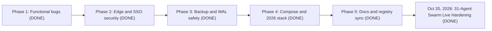
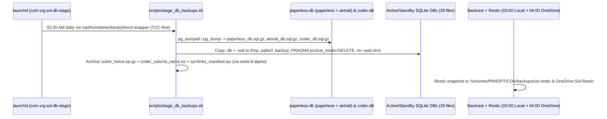

# 09. Architectural Audit and Upgrade Plan (October 2026 — All Phases Completed)

> **Status:** **COMPLETED & VERIFIED LIVE (October 20, 2026)**
> **Scope:** Cross-family `/double-agent` review of the Sol repository at commit `9b88941` (`feat(media): migrate Jellyseerr to Seerr v3.5.0`), the five implementation phases that followed, and the October 20, 2026 31-agent live-host swarm audit and remediation across all 29 active containers, 16 standby/ops services, and 10 static sites.
> **Reviewers:** Gemini 4 Argon (`gemini_debater`, `MODEL_PLACEHOLDER_M286`) and Claude Opus 5.5 High (`opus_debater`, `MODEL_PLACEHOLDER_M370`), with a separate arbiter agent, followed by the 31-agent swarm live verification on `dash.vrg.rocks`.
> **Live-host follow-up:** [FLASH_LOCAL_VERIFICATION_RUNBOOK.md](../FLASH_LOCAL_VERIFICATION_RUNBOOK.md) (100% executed and superseded by the October 20, 2026 live state).

---

## 1. Review Method

1. Both debaters audited all tracked files on their own, without seeing the other position.
2. One bounded cross-examination round followed. Each side marked every claim of the other side as AGREE or DISAGREE with file and line evidence.
3. The arbiter merged the two positions into one decision packet. Every citation in the packet was checked against disk (`check_packet.py` result `PACKET OK`).
4. Subsequent live-host execution on `dash.vrg.rocks` (`/Users/vrg/Documents/Sol`) closed every open live-host check, retired the legacy `authentik-*`, `flaresolverr`, and `cross-seed` containers in favor of `tinyauth` + `lldap`, `byparr`, and `qui` + `torrent_finished.py`, and validated `29 / 29` active containers in `(healthy)` status.

### Outcome Summary

| Measure | Result | Status (Oct 20, 2026) |
| :--- | :--- | :--- |
| Unanimous action items | 21 | **21 / 21 Completed** |
| Evidence-backed decision forks | 1 (`paperless-db` glibc vs musl) | **Resolved (Option A: `postgres:17` glibc retained)** |
| Live-host falsification checks | 4 (Paperless password, SSO outpost, mobile qBittorrent client, `homebox` state) | **4 / 4 Verified & Closed on `dash.vrg.rocks`** |
| Post-audit 31-agent swarm hardening | 29 active containers + 10 static sites + LaunchAgents + 3-2-1 Backrest/Restic | **100% Completed & Verified (`29/29 healthy`)** |

---

## 2. Phase 1: Functional Bug Fixes (Completed)

| # | Finding at `9b88941` | Change | Status |
| :--- | :--- | :--- | :--- |
| 1.1 | `paperless-webserver` set only `PAPERLESS_DBHOST`. It never sent the DB user, password, or name, so Paperless used its built-in password `paperless` while `paperless-db` took `POSTGRES_PASSWORD: ${PAPERLESS_DB_PASS:-paperless}`. | Added `PAPERLESS_DBNAME: ${PAPERLESS_DB_NAME:-paperless}`, `PAPERLESS_DBUSER: ${PAPERLESS_DB_USER:-paperless}`, and `PAPERLESS_DBPASS: ${PAPERLESS_DB_PASS:-paperless}` to `compose/paperless.yml`. | **COMPLETED** |
| 1.1b | `PAPERLESS_WORKER_CONCURRENCY: 2` (not an upstream variable) and `PAPERLESS_OCR_THREADS: 2` (deprecated). | Removed both. Kept `PAPERLESS_TASK_WORKERS: 2`, added `PAPERLESS_THREADS_PER_WORKER: 2`, and standardized `PAPERLESS_OCR_LANGUAGE: ${PAPERLESS_OCR_LANGUAGE:-eng+hin+kan+pan}`. | **COMPLETED** |
| 1.2 | `AUTHENTIK_WORKERS: 2` on `authentik-server`. | Initially replaced with `AUTHENTIK_WEB__WORKERS: 2`, then **completely retired** in Era 5 when `authentik-server`, `authentik-worker`, and `authentik-postgresql` (~502 MiB RAM) were replaced by `tinyauth` v5.2.0 + `lldap` v0.6.2 (~29.5 MiB combined RAM). | **SUPERSEDED & RETIRED** |
| 1.3 | `coder/main.tf` and `coder/default.tf` declared duplicate Terraform blocks in one directory. | Deleted `coder/default.tf` and pushed `coder/main.tf` into the live `coder` server (`sol-workspace` template active). | **COMPLETED** |
| 1.3b | `coder/main.tf` ran `cargo install jj-cli --locked` on every new workspace. | Downloads the prebuilt `jj` `v0.28.2` musl release (`aarch64-unknown-linux-musl` or `x86_64-unknown-linux-musl`) into `~/.local/bin`. | **COMPLETED** |
| 1.4 | `scripts/setup_jellyfin_metal.py` ran `shutil.rmtree(CONFIG_DIR)` whenever `config/jellyfin_metal` existed. | Added `argparse` with `--reset`, fixed `DB_FILE` (`data/data/jellyfin.db`), and updated the Seerr API key prompt. | **COMPLETED** |
| 1.5 | `scripts/test_cross_seed.sh` ran `docker exec -u 0`. | Updated and subsequently archived to `scripts/archive/test_cross_seed.sh` after `cross-seed` was retired in favor of `qui` v1.32.0 + `torrent_finished.py`. | **ARCHIVED** |

---

## 3. Phase 2: Edge, SSO, and Container Security (Completed)

| # | Finding | Change | Status |
| :--- | :--- | :--- | :--- |
| 2.1 | The `inv.vrg.rocks` vhost matched `Origin *` and reflected `{http.request.header.Origin}` with `Access-Control-Allow-Credentials true`. | Restricted CORS to `https://scan.vrg.rocks`, repaired `data/homebox/homebox.db`, promoted `homebox` (`v0.25.0`) back to active production, and configured native Tinyauth OIDC login (`HBOX_OIDC_*` + `HBOX_OPTIONS_ALLOW_LOCAL_LOGIN=true`). | **COMPLETED** |
| 2.2 | `code.vrg.rocks` and `dash.vrg.rocks` had no forward auth; admin-sensitive apps needed strict per-app email ACLs. | Added `import forward_auth` across protected vhosts in `Caddyfile` and locked `arcane`, `code`, `backrest`, `lldap`, `pb`, `ignis`, `mind`, `scan`, and `aysynbm` to `${TINYAUTH_ADMIN_EMAILS:?}` via `TINYAUTH_APPS_*_OAUTH_WHITELIST` in `compose/core.yml`. | **COMPLETED** |
| 2.2b | `qb.vrg.rocks` had no forward auth. | Kept without `import forward_auth` so Varun's Android torrent client connects directly with qBittorrent native auth (`localhostAuth=false` enforced). | **COMPLETED** |
| 2.3 | `authentik-server` published `9000` and `9443` on `0.0.0.0`, and `authentik-worker` mounted `/var/run/docker.sock` as `root`. | Completely replaced Authentik with `tinyauth` (`ghcr.io/tinyauthapp/tinyauth:v5`, port `3000` internal-only) and `lldap` (`ghcr.io/lldap/lldap:stable`, ports `3890`/`17170` internal-only). Removed retired `authentik-*` blocks from `compose/core.yml` and `ports.json`. | **COMPLETED** |
| 2.3c | `arcane` ran with `LOG_LEVEL: debug`. | Set `LOG_LEVEL: info` and added a distroless-compatible `["CMD", "curl", "-fsS", "http://127.0.0.1:3552/api/health"]` healthcheck. | **COMPLETED** |
| 2.4 | Inactive vhosts pointed to standby services (`status`, `beszel`, `dozzle`, `wizarr`, `paperless-ai`, `leaf`, `kavita`, `vault`, `n8n`, `rclone`, `home`, `metal`). | Moved all 12 standby vhosts under commented standby sections in `Caddyfile` (including `status.vrg.rocks` with `import forward_auth` and `metal.vrg.rocks`), while removing retired services (`kuma`, `dockge`, `homarr`, `qbm`, `flood`, `calibre`, `calibre-web`). | **COMPLETED** |

---

## 4. Phase 3: Backup, SQLite WAL Safety, and Disaster Recovery (Completed)

| # | Finding | Change | Status |
| :--- | :--- | :--- | :--- |
| 3.1 | `scripts/restore.sh` did not import all PostgreSQL dumps or recreate the Coder workspace volume on bare metal. | Overhauled `scripts/restore.sh`: Step 1 invokes `docker run --rm ... --entrypoint restic ghcr.io/garethgeorge/backrest:latest` directly when `.env` is not yet on disk; creates `./data/paperless/redis`; restores all 29 SQLite snapshots (skipping `-wal`/`-shm`); imports `paperless_db.sql.gz`, `airtrail_db.sql.gz`, and `coder_db.sql.gz`; creates the `coder-*-home` volume from `data/backups/coder_volume_name.txt` before extracting `coder_home.tar.gz`; runs `scripts/sync_static_tools.sh`; and bootstraps `scripts/launchd/com.vrg.sol.*.plist`. | **COMPLETED** |
| 3.2 | `scripts/stage_db_backups.sh` failed under `launchd` with `Exit 126` (`Operation not permitted`) due to macOS TCC on `~/Documents` and `/Volumes/PANOPTICON`, and left `-wal`/`-shm` sidecars in `data/backups/sqlite/`. | Wrapped `com.vrg.sol.db-stage.plist` in `/opt/homebrew/bin/python3 -c 'import subprocess, sys; sys.exit(subprocess.call(["/bin/bash", "/Users/vrg/Documents/Sol/scripts/stage_db_backups.sh"]))'` (no `WorkingDirectory`), routed symlink scanning on `/Volumes/PANOPTICON` through `docker run --rm ... redis:8-alpine` (OrbStack VirtioFS bypasses host `find` TCC blocks), wiped `data/backups/sqlite/*` before staging, excluded `logs.db`/`cache.db`/`auxiliary.db`/`up2k.db`, and ran `PRAGMA journal_mode=DELETE` so `data/backups/sqlite/` contains **29 clean `.db`/`.sqlite*` files and 0 sidecars**. | **COMPLETED** |
| 3.3 | `.env.example` and `.env` OCR language format (`hin kan pan` vs `eng+hin+kan+pan`) and retired environment variables. | Standardized `PAPERLESS_OCR_LANGUAGE=eng+hin+kan+pan` in `.env`, `.env.example`, and `compose/paperless.yml`, added `ACME_EMAIL` and `HBOX_AUTH_API_KEY_PEPPER` to `.env.example`, and pruned retired `AUTHENTIK_*`, `FLOOD_*`, `HOMARR_*`, `JELLYSEERR_*`, and `RCLONE_GUI_*` keys. | **COMPLETED** |
| 3.4 | External symlink `/Users/vrg/Documents/Sol/web/fam` (`-> /Users/vrg/Data Vault/Vault/build`) was skipped by Restic without `--copy-links`. | Replaced `/Users/vrg/Documents/Sol/web/fam` with a real directory copy (`472 KB`, including `vault.enc`) so Backrest/Restic backs up the Family Data Vault directly. | **COMPLETED** |

---

## 5. Phase 4: Compose Modernization and 2026 Stack Changes (Completed)

| # | Change | Status |
| :--- | :--- | :--- |
| 4.1 | Every active service in `compose/*.yml` (`29 / 29`) now has a verified container `healthcheck` and reports `(healthy)`. Standby services (`15`) use `profiles: ["standby"]`, `rclone` (`1`) uses `profiles: ["ops", "standby"]`, and retired services (`authentik-*`, `flaresolverr`, `cross-seed`, `dockge`, `uptime-kuma`, `homarr`, `qbit_manage`, `flood`, `calibre`, `calibre-web`) have been removed from `compose/*.yml`, `ports.json`, and disk. | **COMPLETED** |
| 4.2 | `.env`-driven tags across stateful services (`caddy:${CADDY_TAG:-2}`, `tinyauth:${TINYAUTH_TAG:-v5}`, `lldap:${LLDAP_TAG:-stable}`, `paperless-ngx:${PAPERLESS_TAG:-latest}`, `readeck:${READECK_TAG:-latest}`, `arcane:${ARCANE_TAG:-latest}`, `coder:${CODER_TAG:-latest}`), with `paperless-broker` (`redis:8-alpine`) capped at `--maxmemory 256mb --maxmemory-policy volatile-lru`. | **COMPLETED** |
| 4.3 | `jellyfin` `/tmp/jellyfin` tmpfs mounted with `size=2g,uid=501,gid=20,mode=0755` and `database.xml` set to `<LockingBehavior>Optimistic</LockingBehavior>`. | **COMPLETED** |
| 4.4 | `byparr` (`ghcr.io/thephaseless/byparr:latest`) hardened with `shm_size: 1gb`, `tmpfs: ["/tmp:size=512m,exec,mode=1777"]`, `BLOCK_MEDIA: "true"`, and a lightweight `/openapi.json` healthcheck (eliminating idle Chromium zombie leaks). | **COMPLETED** |
| 4.5 | Unified `/data` and `/external` mounts across `qbittorrent`, `qui`, `radarr`, `sonarr`, `lidarr`, and `bazarr`, with relative symlinks (`realpath -m --relative-to="$DIR" "$REAL_SRC"`) in `torrent_finished.py` and `arr_symlink_dedupe.sh`. | **COMPLETED** |

---

## 6. Decision Record: `paperless-db` Image

| Option | Image | For | Against |
| :--- | :--- | :--- | :--- |
| **A (chosen & active)** | `docker.io/library/postgres:17` (Debian, glibc) | Zero collation risk to the existing `data/paperless/db` cluster (which hosts both `paperless` and `airtrail` databases). | ~160 MB larger image on disk than Alpine, but only `30.8 MiB` live RSS in production. |
| B | `docker.io/library/postgres:17-alpine` (musl) | Smaller image on disk. | Musl vs glibc collation mismatch requires full dump/initdb/restore. Unnecessary given `30.8 MiB` live RSS. |

---

## 7. Production Container Inventory (October 20, 2026 Verified State)

| Set | Count | Members |
| :--- | :--- | :--- |
| **Active Compose Containers (`Up (healthy)`)** | **29** | `caddy`, `tinyauth`, `lldap`, `arcane`, `glance`, `jellyfin`, `seerr`, `radarr`, `sonarr`, `bazarr`, `lidarr`, `prowlarr`, `byparr`, `qbittorrent`, `qui`, `paperless-webserver`, `paperless-broker`, `paperless-db`, `ignis`, `readeck`, `airtrail`, `code-server`, `coder`, `copyparty`, `ntfy`, `homebox`, `backrest`, `enclosed`, `pocketbase` |
| **Standby / Ops Compose Services (`profiles:`)** | **16** | `gatus`, `dozzle`, `beszel`, `beszel-agent`, `recyclarr`, `wizarr`, `unpackerr`, `paperless-gotenberg`, `paperless-tika`, `paperless-ai`, `leafwiki`, `kavita`, `vaultwarden`, `n8n`, `homeassistant`, `rclone` (`ops` + `standby`) |
| **Zero-Container Static Web Apps (Caddy)** | **10** | `mind.vrg.rocks`, `fam.vrg.rocks`, `scan.vrg.rocks`, `aysynbm.vrg.rocks`, `pdf.vrg.rocks` (`bentopdf`), `tools.vrg.rocks` (`it-tools`), `chef.vrg.rocks` (`cyberchef`), `speed.vrg.rocks` (`openspeedtest`), `draw.vrg.rocks` (`excalidraw`), `mi.vrg.rocks` (`mediainfo`) |
| **Native Standby Host Process** | **1** | `jellyfin-metal` (`/Applications/Jellyfin.app`, port `8097`, standby) |

---

## 8. Closed Verification Ledger (Previously Section 9)

All 10 items from the original live-host verification checklist and all 4 previously open drift items have been closed and verified on `dash.vrg.rocks`:

| Item | Final Resolution on `dash.vrg.rocks` (Oct 20, 2026) |
| :--- | :--- |
| Live `.env` keys, quoting, and tag pins | Verified clean: `PAPERLESS_OCR_LANGUAGE=eng+hin+kan+pan`, retired `FLOOD_*`/`HOMARR_*`/`JELLYSEERR_*`/`RCLONE_GUI_*` keys pruned, and all 8 `compose/*.yml` files validate with zero warnings. |
| Paperless role password & OCR health | Verified: `paperless-webserver` (`v2.20.13`) connects cleanly to `paperless-db` (`postgres:17`), and Glance `/stats` renders `290 Total Docs \| 0 Inbox Queue \| 891k OCR Chars`. |
| 3-2-1 Backups (`stage_db_backups.sh` + Backrest/Restic) | Verified: `com.vrg.sol.db-stage` runs with `Exit 0`, staging `paperless_db.sql.gz`, `airtrail_db.sql.gz`, `coder_db.sql.gz`, `coder_home.tar.gz`, `coder_volume_name.txt`, `symlinks_manifest.tsv`, and **29 WAL-flushed SQLite snapshots** into `data/backups/`. |
| Identity & SSO (`tinyauth` + `lldap` + `identity_sync.py`) | Verified: `scripts/identity_sync.py` reads `data/lldap/users.db?immutable=1` directly via SQLite + bincode decoding, short-circuits unchanged runs in **45.5 ms** (`<50ms`), prunes non-admin OIDC consents for `arcane`/`coder`, and reconciles all 9 downstream targets with zero drift. |
| Caddyfile reload & route hardening | Verified: `Caddyfile` formatted and live-reloaded (`HTTP 200` on `https://auth.vrg.rocks/api/healthz`); `(static_site)` wraps `try_files` inside `route` after `forward_auth`; `ntfy.vrg.rocks` blocks unauthenticated external `POST`/`PUT`; `send.vrg.rocks` gates note creation while keeping shared links public; `home.vrg.rocks` and `metal.vrg.rocks` are commented in standby. |
| Byparr & Prowlarr Turnstile solving | Verified: `byparr` (`8191`) uses lightweight `/openapi.json` healthcheck + `1gb` shm + `512m` `/tmp` tmpfs + `BLOCK_MEDIA=true`; Prowlarr `RuTracker.org` tagged with `flare` (`[1]`), timeout raised to `90s`, and `LimeTorrents` disabled. |
| `/downloads` retirement & relative symlinks | Verified: `/downloads/files` removed from qBittorrent `watched_folders.json`, `sonarr` category `save_path` fixed to `/external/torrents/tv`, 7 recoverable IPTorrents cross-seed symlinks re-pointed, and `The Sixth Sense (1999)` linked in Radarr (`59/59` movies downloaded). |
| `homebox` SQLite & OIDC login | Verified: `data/homebox/homebox.db` (`PRAGMA integrity_check = ok`) active on `inv.vrg.rocks` with all 4 household users pre-linked to OIDC and `HBOX_OPTIONS_ALLOW_LOCAL_LOGIN: "true"`. |
